# Homelab Horizon

A self-contained homelab management tool for WireGuard VPN, split-horizon DNS, reverse proxy, and service monitoring. Single binary, runs on Ubuntu/Debian.

**Website: [homelab-horizon.iodesystems.com](https://homelab-horizon.iodesystems.com)** · the official, original project — accept no clones.

## The Problem

Running a homelab with external access means juggling multiple systems that don't talk to each other:

- **SSL Certificate Sprawl**: Managing 12+ individual certificates, each with their own renewal schedule
- **Internal SSL Headaches**: HTTPS doesn't work from inside your network because certs are tied to external IPs, so you're stuck with HTTP internally or browser warnings
- **Unnecessary Public Exposure**: OAuth callbacks and other endpoints need valid SSL, forcing you to expose internal-only services to the internet just to get certificates
- **Manual DNS Management**: Updating Route53 or other DNS providers by hand every time your IP changes or you add a service
- **Broken Internal Resolution**: Your domains work from the internet but timeout when you're on your own network (the classic split-horizon DNS problem)
- **WireGuard Friction**: Every new device needs a config file, QR code, and manual peer setup on the server
- **Scattered Configuration**: HAProxy configs, DNS records, WireGuard peers, and SSL certs all managed separately with no unified view

## The Solution

Homelab Horizon consolidates all of this into a single web UI:

- **Consolidated Certs**: Wildcard certs only cover one level (`*.example.com` won't cover `app.sub.example.com`), so we make it easy to add extra SANs like `*.vpn.example.com` - all visible and editable in the UI, and you can inspect exactly what each cert covers. No more mystery broken SSL.
- **HTTPS Everywhere**: Same SSL cert works internally - no more HTTP fallbacks or certificate warnings on your LAN
- **Automatic DNS Sync**: Add a service, DNS records update automatically (Route53, Cloudflare, Name.com, and more)
- **Split-Horizon Built-in**: Services resolve to internal IPs on your network/VPN, external IPs from the internet
- **Self-Service VPN**: Generate invite links - users scan a QR code and they're connected
- **Unified Dashboard**: See all your services, their health status, DNS records, and SSL certificates in one place

## Screenshots

### Dashboard
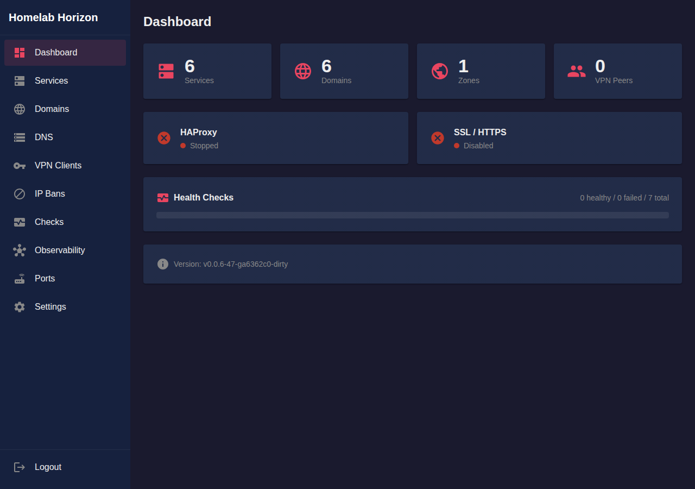

### Services
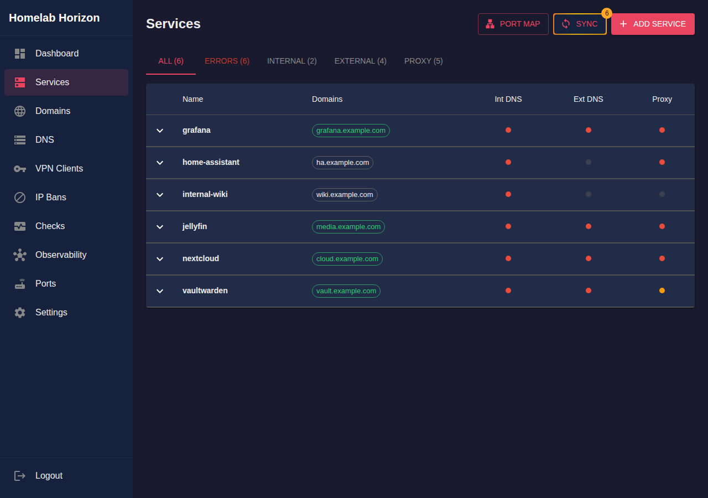

### Service Detail
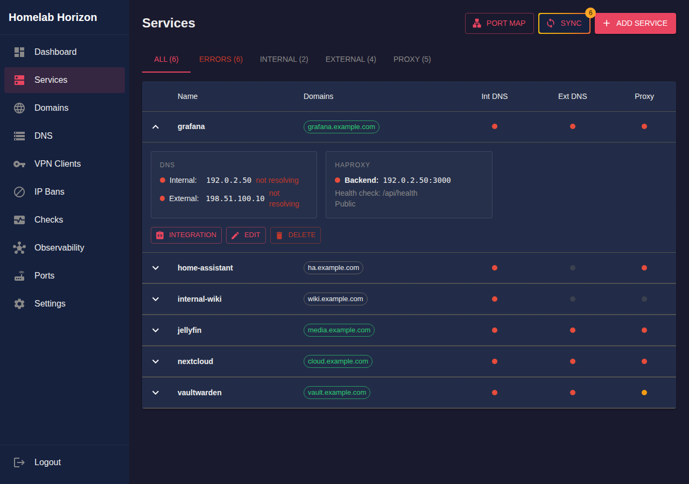

### Deleting a service
Deleting doesn't silently strand the state a service didn't own — the zone
SubZone that gave its domain HTTPS, and the record published at your DNS
provider. Both are listed, and the delete won't proceed until you say whether
to retract them.

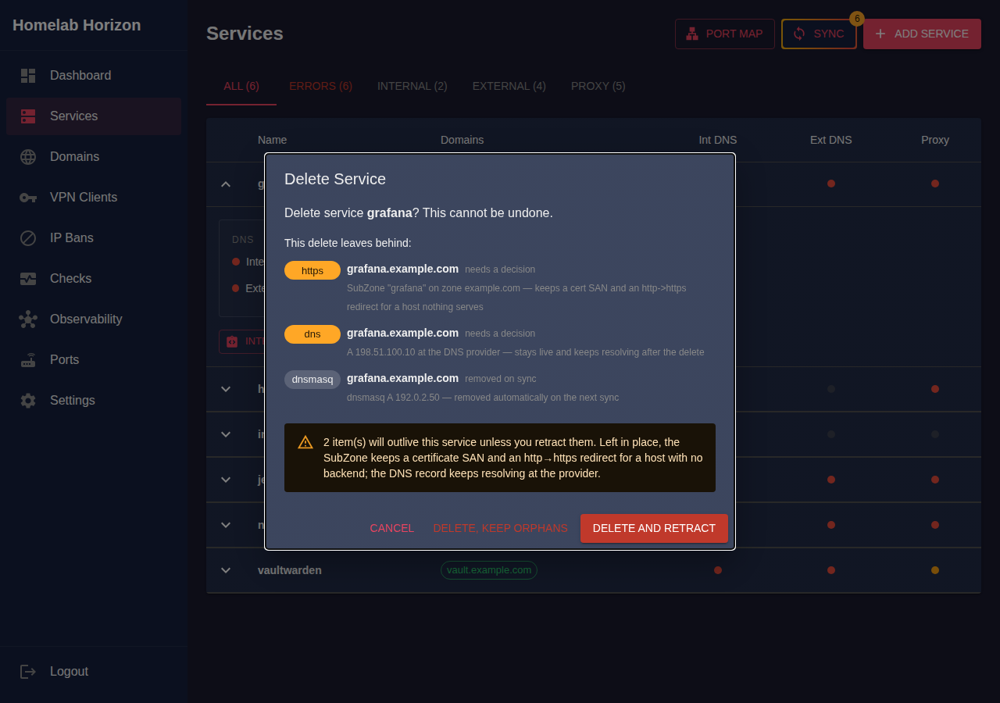

### DNS
Zones hz publishes to, and per zone every record live at the provider labelled
by who owns it — `derived` from a service, `declared` on the zone, `observed`
(not hz's, never rewritten), or `tombstoned` (deletion pending).

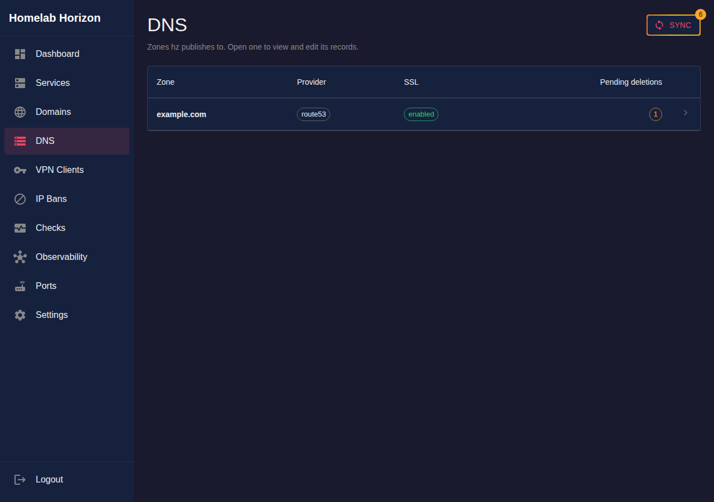

### Domains
Every domain hz knows, with internal DNS, external DNS, proxy and HTTPS state
side by side — plus the SSL coverage gaps and the zone records it publishes.

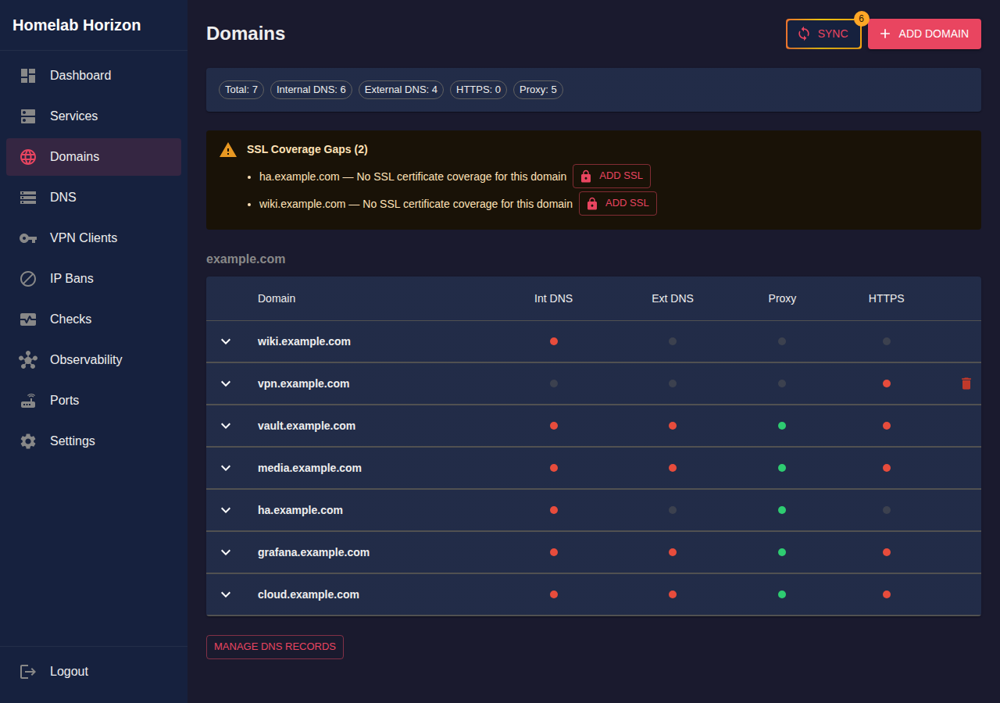

### Observability
Declare hosts and exporter jobs, then hand Prometheus a generated scrape config.

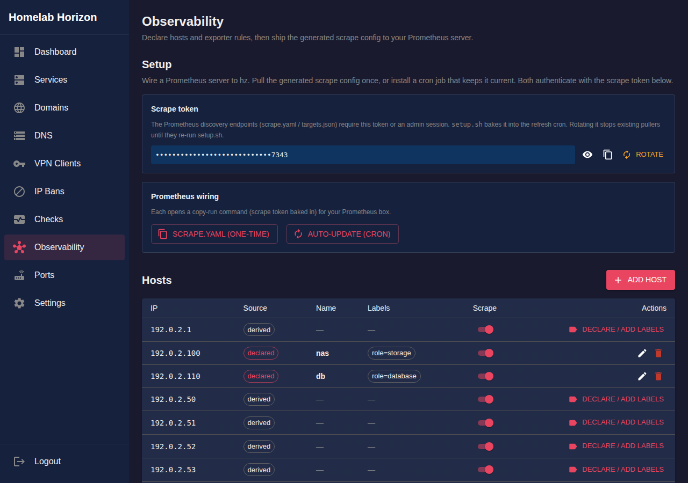

### Ports
Reserved ports per host, and the denylist `hz ports next` skips when allocating.

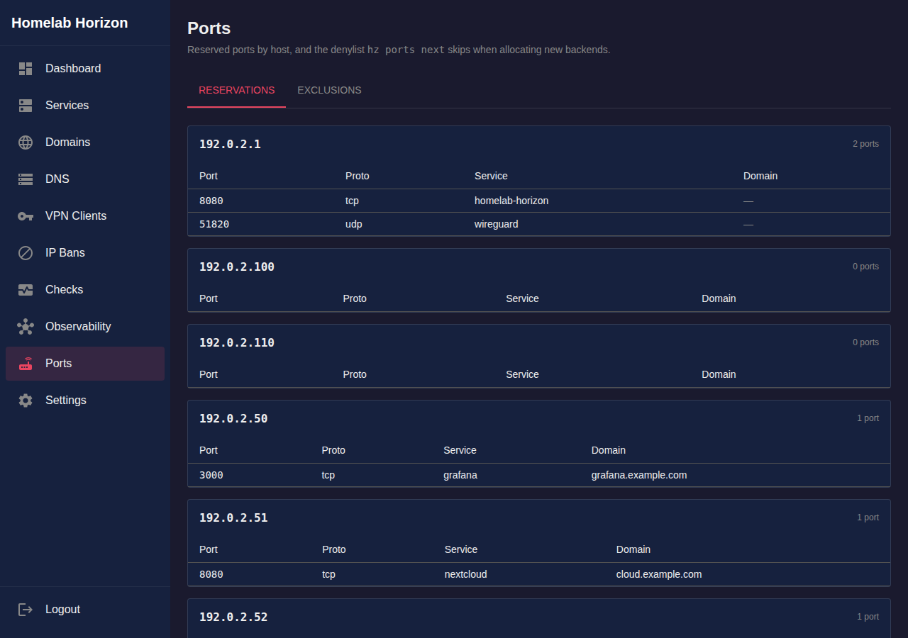

### Port Map
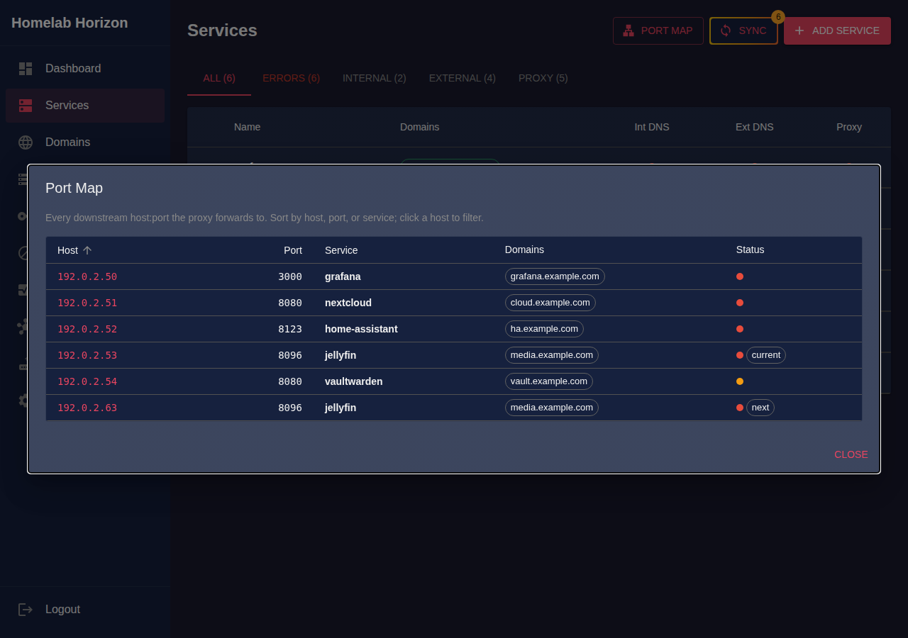

### Settings
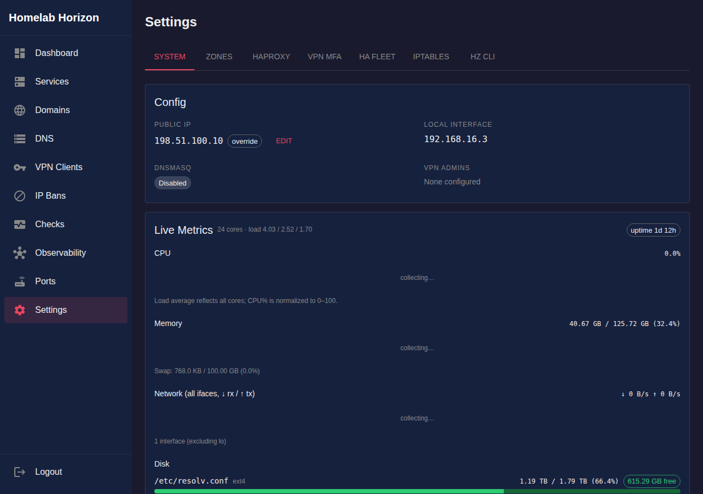

### VPN MFA captive portal
What an MFA-jailed peer sees when it asks for any other service — the request
is redirected to the portal, and nothing else on the network answers until a
second factor is accepted. See [VPN MFA](#vpn-mfa).

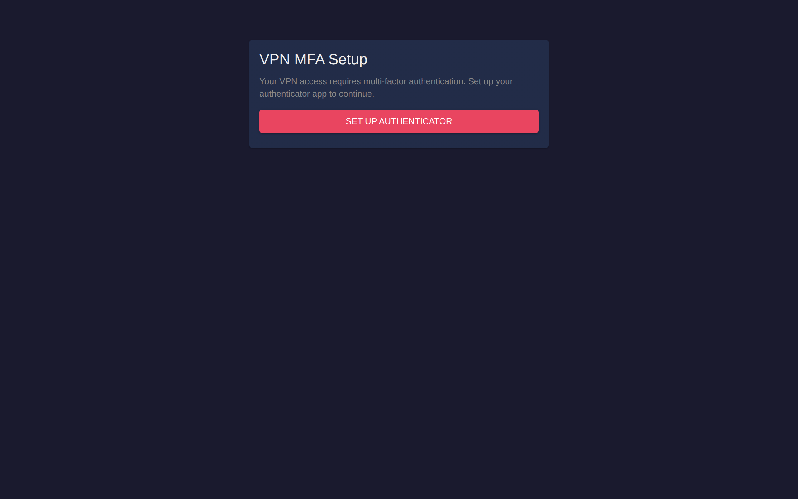

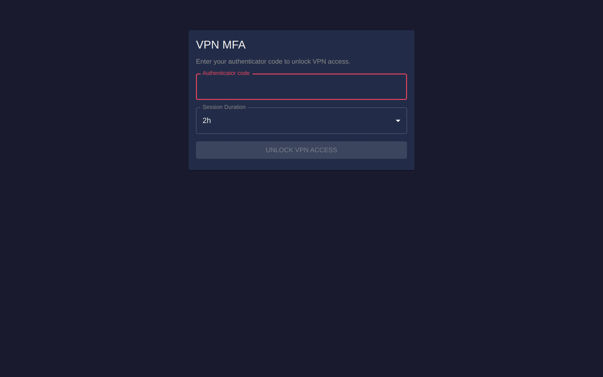

> These two come from `bin/e2e`, not `make screenshots`: the portal identifies
> the caller by WireGuard source IP, so the only honest way to photograph a
> jailed peer's view is to be one. The hermetic container has no WireGuard.

> The VPN and Checks pages are captured too (`docs/screenshots/{vpn,checks}.png`)
> but aren't shown here — the hermetic container has no live WireGuard peers and
> can't reach the documentation IPs it checks, so both render as empty or all-red
> and would misrepresent the pages. `dns-zone.png` (the per-zone record table) is
> likewise captured but not shown: the mock provider serialises the zone's SOA
> value as a Python repr, which looks like an hz bug and isn't one.

> Regenerate with `make screenshots` — boots a hermetic Docker container
> (daemons off, RFC 5737 documentation IPs, no outbound network) and captures
> these with Playwright. See [docs/take-screenshots.mjs](docs/take-screenshots.mjs).
>
> `DNS_FIXTURE=1 ./bin/screenshots` additionally boots a mock Route53
> (`motoserver/moto`) seeded with a zone, so the DNS pages capture real records
> instead of an empty state. Opt-in: it needs the aws CLI and pulls a ~400MB
> image. The DNS shots above were taken with it.

## Features

- **Auto-Heal**: Detects and installs missing dependencies on a fresh Ubuntu system
- **WireGuard VPN Management**: Create clients, generate QR codes, manage peers
- **VPN MFA**: Optional per-peer TOTP or passkey (codes recommended for full-tunnel peers — [why](#️-full-tunnel-peers-phone-scanned-passkeys-do-not-work)). Peers without a verified session are jailed to a captive portal until they authenticate
- **Split-Horizon DNS**: Internal DNS via dnsmasq, external DNS via Route53, Name.com, Cloudflare, and more
- **Reverse Proxy**: HAProxy with automatic Let's Encrypt wildcard SSL certificates
- **Static Sites**: Serve a folder of files as a service — hz hosts it directly, HAProxy routes to it with the same auto SSL/DNS
- **Service Monitoring**: Health checks with ntfy push notifications
- **Outside-In Checks (`hz-probe`)**: A small agent on a host outside the homelab probes your public DNS, HTTPS and latency. hz polls it, so hz stays unreachable from the internet and nothing about the private network leaves the box
- **Prometheus Discovery**: Declare hosts and exporter jobs; hz serves a generated scrape config and probes every target
- **Port Allocation**: Server-authoritative reservations and denylist, so `hz ports next` never hands out a port something already uses
- **Operator CLI (`hz`)**: Service CRUD, HTTPS per domain, hosts, exporters, sync — with a preview of what a mutation actually changes
- **Honest Deletes**: Deleting a service reports the SubZone and DNS record it would strand, and makes you choose
- **Unsynced-Change Tracking**: `hz pending` and a badge in the UI show what's edited but not yet published
- **Self-Service Onboarding**: Users redeem invite tokens to get VPN configs
- **IP Banning**: Per-service IP bans with timeout support
- **Rolling Deploys**: Blue-green deployment support with hz-client CLI
- **Multi-Instance HA**: Run two boxes for automatic config replication, cert failover, and round-robin DNS
- **MCP Server**: Machine-readable API for AI-assisted management

## Quick Start

### Kick the tires (Docker)

```bash
cd examples/simple
./setup.sh            # generate WG keys and config
docker compose up -d  # start HZ
```

Open `http://localhost:8090` and log in with the admin token:

```bash
docker exec hz cat /etc/homelab-horizon/config.json.token
```

### Install from a release

```bash
ARCH=linux-amd64   # or linux-arm64, linux-armv7
curl -fSL -o hz.tar.gz \
  https://github.com/IodeSystems/homelab-horizon/releases/latest/download/homelab-horizon-$ARCH.tar.gz
tar -xzf hz.tar.gz
sudo ./homelab-horizon-$ARCH        # installs itself, then serves
```

One file: the admin UI is compiled into the binary, so there is nothing else to
place. Override with `STATIC_DIR` or `ui_dir` only if you want hz to serve a
frontend of your own.

### Bare metal install (from source)

```bash
# Build (requires Go 1.25+ and Node.js)
make

# Run as root (WireGuard, dnsmasq, HAProxy, iptables, ports 80/443, systemd)
sudo ./homelab-horizon
```

Set the box up with two explicit commands, then start it:

```bash
sudo ./homelab-horizon install        # systemd unit + the directories hz writes into
sudo homelab-horizon install-deps     # wireguard-tools, iproute2, and whatever your config enables
sudo systemctl enable --now homelab-horizon
```

On first run the binary writes an admin token to
`/etc/homelab-horizon/config.json.token`.

Neither step happens on its own. hz does not copy itself into `/usr/local/bin`,
does not rewrite its own unit, and does not run `apt-get` at boot — a daemon
that installs packages at a moment nobody chose can restart something carrying
traffic, and a daemon that can rewrite the unit saying who it runs as has not
really been de-privileged. `install-deps` reports what is missing and why it
matters before installing anything, and `--dry-run` shows the report alone.

Pass config via environment for Docker or backup/restore workflows:

```bash
sudo HZ_CONFIG='{"listen_addr":":8080",...}' ./homelab-horizon
```

### Growing with you

HZ scales from a single box to a redundant pair without reconfiguration. When you're ready, add a second instance:

- **Same-subnet** (two boxes in one rack or VPC): low complexity, shared VPN range, LAN replication
- **Cross-site** (two locations or availability zones): WireGuard tunnel between peers, disjoint VPN ranges, full geo-redundancy

```bash
cd examples/ha-same-subnet && ./setup.sh && docker compose up -d
cd examples/ha-site-to-site && ./setup.sh && docker compose up -d
```

See the [High Availability](#high-availability) section and [examples/](examples/) for details.

## Setup Guide

### Step 1: Get a Domain

You need a domain where you control DNS. Supported providers:

- **AWS Route53**
- **Cloudflare**
- **Name.com**
- **DigitalOcean**
- **Hetzner**
- **Gandi**
- **Google Cloud DNS**
- **DuckDNS**

### Step 2: Configure Your Router

1. **Static DHCP**: Give the Homelab Horizon device a fixed IP
2. **DNS Server**: Point network DNS to the Homelab Horizon device
3. **Port Forwarding**:
   - `51820/UDP` - WireGuard VPN
   - `80/TCP` - HTTP (Let's Encrypt challenges)
   - `443/TCP` - HTTPS (reverse proxy)

### Step 3: Configure Zones & Services

1. Add a DNS zone with your domain and provider credentials
2. Add services — each gets a domain, internal DNS, optional external DNS, and optional HAProxy backend
3. Click "Sync DNS, SSL & HAProxy" to apply everything

## Zones & Domains

A **zone** represents a domain you own (e.g., `example.com`) and connects it to your DNS provider. Once a zone is configured, you can add services under it with any subdomain.

### Wildcard SSL

Each zone automatically gets a wildcard SSL certificate (`*.example.com`) via Let's Encrypt DNS-01 challenges. This means any service like `grafana.example.com` or `wiki.example.com` gets valid HTTPS with no per-service cert management.

For deeper subdomains, add **sub-zones**. For example, adding `"vpn"` as a sub-zone to `example.com` gets you a `*.vpn.example.com` wildcard — so VPN client names like `carl.vpn.example.com` also get valid SSL.

### Adding Services

Once your zone is set up, adding a service is straightforward:

- **Name**: human-readable identifier (e.g., `grafana`)
- **Domains**: one or more FQDNs under your zone (e.g., `grafana.example.com`)
- **Internal DNS**: the LAN IP that VPN/local clients should resolve to (e.g., `192.168.1.50`)
- **External DNS**: enables public DNS records pointing to your public IP (auto-detected)
- **Proxy**: HAProxy backend (`host:port`) — can be a LAN service or an external host

Services don't have to be on your local network. The proxy backend can point to any reachable host:port — a Raspberry Pi on your LAN, a VM in the cloud, or a container on the same machine.

### Managing services from the CLI (`hz`)

`hz` is an operator CLI for driving a whole instance from your workstation — service list/show/create/edit/delete plus a global sync. It's distinct from the per-service `hz-client` (which is service-token scoped, for deploys/bans/site uploads): `hz` authenticates with the instance **admin token**.

Install it straight from the instance (detects your OS/arch, drops the binary in `~/.local/bin` or `/usr/local/bin`, and — if you pass a token — writes `~/.hz_config`):

```bash
curl -fsSL $HZ_URL/admin/hz/install | HZ_HOST=$HZ_URL HZ_TOKEN=<admin-token> bash
```

The binaries are served by the instance itself (no GitHub needed). Omit `HZ_TOKEN` to install the binary only, or build locally with `make build-hz`. Either way `hz` reads `~/.hz_config`:

```json
{ "host": "http://192.168.1.89:8080", "token": "<admin-token>" }
```

(`HZ_HOST`/`HZ_TOKEN` env or `--host`/`--token` flags override the file.)

```bash
hz service list                      # table of all services
hz service show grafana --json       # one service
hz setup                             # interactive questionnaire -> create + sync
hz service create --name ebb --domain ebb.example.com \
    --backend 192.168.1.76:8300 --internal-only --health-check /healthz --sync
hz service edit ebb --public         # only the flags you pass change
hz service create --name shop --domain lan.example.com \
    --domains-https www.example.com --backend 192.168.1.76:8080
                                     # lan.example.com stays HTTP, www.example.com gets HTTPS
hz service edit ebb --https --confirm # HTTPS on every domain of the service
hz domain list                       # every domain: service, zone, HTTPS coverage, cert
hz domain ssl add ebb.example.com    # give one domain HTTPS
hz domain ssl rm ebb.example.com --confirm
                                     # drop it back to plain HTTP
hz service delete ebb                # reports what the delete would strand, then refuses
hz service delete ebb --delete-orphans --sync
                                     # ...also retract the SubZone + published DNS record
hz sync --wait                       # trigger a global sync, block until done
hz pending                           # show unsynced config changes
hz ports list --host 192.168.1.76    # reserved ports on a host + suggested free ports
hz ports next --host 192.168.1.76 --count 100
                                     # next free port range (safe band 20000+, common dev ports skipped)
hz schema service                    # dump the request schema (reflected from apitypes)
```

`hz --help` lists every command and flag; `hz schema service` prints the exact JSON request shape the server accepts (generated from the shared `internal/apitypes` structs, so it never drifts).

Deleting is the one mutation that can leave state behind, because a service
doesn't own everything it depends on. The zone SubZone giving its domain HTTPS
lives on the *zone*, and the record published at your DNS provider lives at the
*provider* — neither disappears with the service. `hz service delete` prints
both and stops until you pick `--delete-orphans` or `--keep-orphans`:

```
$ hz service delete grafana
Deleting "grafana" leaves behind:

  ! https grafana.example.com            SubZone "grafana" on zone example.com — keeps a cert SAN and an http->https redirect for a host nothing serves
  ! dns   grafana.example.com            A 198.51.100.10 at the DNS provider — stays live and keeps resolving after the delete
  . dns   grafana.example.com            dnsmasq A 192.0.2.50 — removed automatically on the next sync

  ! needs a decision   . goes away on sync   = shared, left alone

error: this delete strands 2 item(s) listed above — re-run with --delete-orphans or --keep-orphans
```

Coverage inherited from a wildcard SubZone, and any SubZone another service
still uses, are reported as shared and never offered for deletion. A service
that strands nothing deletes without asking anything.

### Backup

hz never sends a backup anywhere. A machine you choose **pulls** it with an
admin credential (`GET /admin/backup/export`) and keeps it:

```bash
hz backup pull --dir ~/backups/hz-office --keep 14   # download, verify, write, prune
hz backup verify ~/backups/hz-office/hz-backup-hz.example.com-20261002T030000Z.zip
hz backup install-timer --dir ~/backups/hz-office     # systemd USER timer, daily; --enable starts it
```

The zip contains `manifest.json`, `config.json`, the admin token,
`wireguard.conf`, `invites.txt`, the certificates in `certs/live/`, the build
logs in `builds/`, and `hz.db`. It does **not** contain `<data dir>/artifacts/`
(release artifacts: large, re-uploadable, their sha256s are in `hz.db`) or
`<data dir>/child-bin/`; the manifest's `excluded` lists both.

`hz.db` is an online snapshot (`VACUUM INTO`), so it has what is still in the
WAL. A copy of the `.db` file would not. Before hz serves the zip, it opens
the snapshot read-only and checks three things: `integrity_check` is ok, the
schema version is the running binary's latest migration, and the row counts
equal the counts read from the live database. If a check fails, hz answers
500 with the reason. `hz backup pull` checks the zip again on your machine:
every sha256 in the manifest, integrity, a recorded schema version, and the row
counts. If a check fails, it exits non-zero with `LOUD` and writes nothing. It
writes the file 0600, atomically. `hz backup verify` also checks that the
snapshot can be restored into the hz you run: its schema must not be newer.

**The backup carries the config manager's wrapped environment keys and every
sealed config value.** Those open only with a machine private key or a recovery
key, neither of which is in the zip. But a leaked backup now exposes more: it
already had the admin token, a WireGuard private key and TLS private keys, and
now it has every blob the config manager holds, and the identity store: users,
bcrypt password hashes, **TOTP seeds**, and session and API-token digests. Keep
it as a secret.

Restore: `POST /admin/backup/import` with the zip. A zip with `hz.db` is checked
as a whole before hz writes anything. hz refuses a snapshot whose schema is
newer than its own. hz does not write the database over the open one. It stages
it as `<db path>.restore` and answers `"restart_required": true`. At the next
start, before the database opens, hz puts it in place and keeps the old one as
`hz.db.pre-restore-<time>`. If the staged file fails the same checks at that
time, hz sets it aside as `.rejected-<time>` and starts on the existing
database (`LOUD` in the log). A zip with no manifest is from before `hz.db` was
in the backup. It imports as before.

### Static Sites

A service can serve a folder of files instead of proxying to a backend. Set `proxy.static_root` to an absolute directory (mutually exclusive with `proxy.backend`):

```json
{
  "name": "docs",
  "domains": ["docs.example.com"],
  "external_dns": { "ttl": 300 },
  "proxy": { "static_root": "/var/lib/homelab-horizon/docs" }
}
```

HAProxy can't serve a directory itself, so hz runs a small internal file server (loopback-only, port `static_serve_port`, default `8091`) and routes the service's domains to it by Host header. Static services inherit wildcard SSL, split-horizon DNS, and the `internal_only` restriction exactly like proxied ones.

hz runs as root, but **the file server does not**: it runs as a separate child process dropped to the unprivileged `nobody` user, so it physically cannot read files `nobody` can't — even a bug in the handler can't leak root-only secrets. (If hz can't drop privileges, it refuses to serve static rather than serve as root.) The served directory must therefore be readable by `nobody`.

On top of that, the file server is deliberately strict:

- Bound to `127.0.0.1` only — never directly reachable off-box.
- Every file open is pinned inside `static_root` via `os.Root`; `../` and symlinks **cannot** escape the directory.
- Dotfiles and dot-directories (`.git`, `.env`, `.ssh`) are never served.
- Directories are never listed — a directory serves its `index.html` or returns 404.
- `static_root` cannot be the filesystem root or a system directory (`/etc`, `/root`, `/proc`, …) — checked even through symlinks.
- `Content-Type` is set explicitly from the file extension (no content sniffing), and `X-Content-Type-Options: nosniff` is sent on every response.
- Errors render a standard hz error page, or the site's own `404.html` / `5xx.html` if present. (A wholly missing/unreadable root can't read its own error page, so that case always shows the built-in page.)

Point `static_root` at a directory containing only files you intend to publish.

For single-page apps, set `"spa": true` so a browser refresh on a client-side route (a path with no file extension) serves `index.html` instead of 404:

```json
{ "name": "app", "domains": ["app.example.com"],
  "proxy": { "static_root": "/var/lib/homelab-horizon/app", "spa": true } }
```

### Deploying a static site

Upload a directory with `hz-client` (the same token-authed client used for rolling deploys; grab the snippet + token from the service's **Integration** panel in the UI):

```bash
export HZ_TOKEN=<service token>  HZ_URL=https://hz.example.com
curl -sO "$HZ_URL/admin/haproxy/hz-client" && chmod +x hz-client

./hz-client site push ./public             # upload as a new release, atomic swap
./hz-client site push ./public --validate  # dry run: extract + validate, no swap
./hz-client site releases                  # list retained releases
./hz-client site rollback                  # revert to the previous release
```

Deploys are **atomic**: the upload is extracted into a fresh release directory, then `static_root` (an hz-managed symlink) is repointed in a single rename — requests never see a half-written site. The last few releases are retained for `rollback`. Uploads are received by the root process, validated (no path traversal, no symlinks, size/file caps), and the files are owned by `nobody` so the unprivileged file server can read them.

This is how the project hosts its own landing page (`docs/`): a static service on the public domain, served by hz, with auto SSL.

### Promoting a release (staging → prod)

hz does not put a build on a box. It records what each rung **reported** running, gates a promotion on that evidence, and answers whether a given bundle may be deployed to a rung. Three endpoints and one CLI command:

```bash
# 1. After a successful deploy to ANY rung (staging, and prod too), the deploy reports
#    what it shipped. A rung's supported lines come from these reports, so a prod
#    deploy that does not report leaves prod with no supported line.
#    Token: an admin API token (any rung), OR the service token of a service
#    assigned to exactly this project/environment (that rung only; 403 otherwise).
curl -sf -X POST "$HZ_URL/api/v1/deploys/report" -H "Authorization: Bearer $HZ_TOKEN" \
  -d '{"project":"redline","environment":"staging","app":"redline",
       "version":"1.4.0","describe":"v1.4.0-3-gabc123",
       "artifact_sha256":"<64 hex>","host":"ubuntu@192.168.1.160",
       "build_url":"https://ci.example/builds/7"}'
# -> 200 {"recorded":true,"id":12}     400 {"error":"..."} undeclared rung, bad version, bad sha256,
#    build_url over 2048 bytes or carrying a control character. build_url is optional, any scheme.

# 2. The app keeps one backup per supported line, and says so. Token: admin, or the
#    service token of a service in this PROJECT (any rung of it).
#    taken_by_version must be on the line. The newest record per (project, line) wins.
curl -sf -X POST "$HZ_URL/api/v1/backups/kept" -H "Authorization: Bearer $HZ_TOKEN" \
  -d '{"project":"redline","line":"1.0.0","backup_sha256":"<64 hex>",
       "location":"s3://redline-kept/1.0.0.sql.zst","taken_by_version":"1.0.0-0.1",
       "build_url":"https://ci.example/builds/5"}'
# -> 200 {"recorded":true,"id":4}

# 3. Staging restores that backup with the new build, migrates, runs the tests, and
#    reports the result. Token scoped like a deploy report: its own rung only.
#    "passed" is REQUIRED; a failure is reported too.
curl -sf -X POST "$HZ_URL/api/v1/restore-tests/report" -H "Authorization: Bearer $HZ_TOKEN" \
  -d '{"project":"redline","environment":"staging","version":"1.0.1-0.3","line":"1.0.0",
       "backup_sha256":"<the kept backup sha256>","passed":true,
       "build_url":"https://ci.example/builds/7"}'
# -> 200 {"recorded":true,"id":9}

# 4. Promote. Refused (409, reason in "error") unless prod declares `from: staging`
#    at a higher posture, staging's NEWEST report is X, X is not lower than prod's
#    declared version (unless --allow-downgrade, recorded as a downgrade), AND, for
#    every line prod supports BEFORE the promotion (the lines prod REPORTED running —
#    not its declared version), a kept backup exists and X's newest
#    restore test on staging against that backup's sha256 passed. Each failing line is
#    its own sentence (newline-separated):
#      line 1.0.0 is supported on redline/prod but has no kept backup
#      1.0.1-0.3 has no restore test against line 1.0.0's kept backup cccccccccccc
#      1.0.1-0.3 failed its restore test against line 1.0.0 (https://ci.example/builds/7)
#    Sets prod's version and records who promoted which artifact sha256 and build_url,
#    when, and which lines were checked with which restore test.
hz env promote redline staging prod --version 1.0.1-0.3 [--allow-downgrade] [--skip-restore-tests]
#    = POST /api/v1/environments/promote
#      {"project":"redline","from":"staging","to":"prod","version":"1.0.1-0.3","allowDowngrade":false,"skipRestoreTests":false}
#    -> 200 {"promoted":true,"version":"1.0.1-0.3","artifact_sha256":"<hex>","build_url":"...",
#            "downgrade":false,"id":3,
#            "restore_tests":"checked 1 line(s) of redline/prod: 1.0.0 (restore test #9)",
#            "lines_checked":[{"line":"1.0.0","why":"current","kept_backup_id":4,
#                              "backup_sha256":"<hex>","restore_test_id":9}]}
#    A target that has reported running nothing (the first release, or a rehearsal
#    promote into a prod with no box) requires none and says so:
#    "restore_tests":"none required: redline/prod has reported running nothing yet".

# 5. The lines, per rung — supported and why, kept backups, the next promotion's
#    restore tests, retired lines. Admin.
hz lines redline                     # = GET /api/v1/projects/lines?project=redline
hz line pin redline 0.9.0 --reason "legacy import still restores 0.9"
hz line unpin redline 0.9.0          # = POST /api/v1/projects/lines/{pin,unpin}

# 6. Before deploying to prod, ask. Admin API token.
curl -s "$HZ_URL/api/v1/deploys/check?project=redline&environment=prod&version=1.4.0&artifact_sha256=<hex>" \
  -H "Authorization: Bearer $HZ_ADMIN_TOKEN"
# -> 200 {"ok":true}
# -> 409 {"ok":false,"reason":"..."}  prod declares another version; the artifact differs
#        from the one promoted; the version was set by hand, not promoted; nothing declared
```

- **Versions** are semver with no leading `v` and no `+build` (that goes in `describe`); a prerelease such as `1.0.0-rc.1.1414` is accepted and ordered by semver precedence.
- **Encoding a four-part version.** A `MAJOR.MINOR.FIX.HOTFIX#BUILD` version travels as semver `MAJOR.MINOR.FIX-HOTFIX.BUILD`: `1.9.1.0#7` → `1.9.1-0.7`. hz parses semver only; put the human form in `describe`.
- **A line** is a version's `MAJOR.MINOR.PATCH`: `1.9.0-1.2` is on line `1.9.0`, so hotfixes and rebuilds stay on their line. A rung **supports** the line of its newest deploy report (*current*), the newest *different* line it reported running before that (*prior*), and any line its project **pins** (`hz line pin`, reason required; declared in `config.json`). A line exists on a rung once something on that rung reported running it: a promote declares what the rung *should* run and adds no line, so a promote into a rung whose deploy never reports demands no restore test of the next one. hz derives the supported lines on every read and promote; nothing stores them. A report row hz cannot read a line from, or a pin that is not a line, is reported as "hz cannot say" and the promote is refused.
- **Retired lines** have a kept backup and are supported on no rung. The app may delete those backups; hz says so in `hz lines` and deletes nothing.
- The restore test that counts is the newest one of version X **on the source rung** against the line's **newest** kept backup. A test against an older backup of the line is superseded. The gate also applies to `--allow-downgrade`, unless you also pass `--skip-restore-tests` (`skipRestoreTests`). hz accepts that only for the exact build (version and artifact sha256) already promoted into the target, so only for a rollback to something that ran there. The skip is recorded on the promotion (`restore_gate: "skipped-ran-before"`). The source rung must still report that build first. Data migrated forward may not be readable by the older build; the skip does not check that.
- **Repeat reports** append: the same version may be reported again with a different sha256 (a rebuild). The newest report wins; the promote pins its sha256; the check compares against the pin.
- Reports, promotions, kept backups and restore tests are append-only rows in `hz.db` on the config primary (migrations `0014`, `0015`, `0016`). They are **not** peer-synced; they are in the backup (see [Backup](#backup)); a check asked of an HA peer finds no promotion and refuses.
- `promote` and `check` need an admin credential. hz has one privilege level, so the gate stops an untested version, not a person; what it adds is the record (`promoted_by`). The project Overview shows the newest report per rung (with its build link), a Promote action on any rung with a `from` edge — its dialog lists the required restore tests before the button — recent promotions, and the release lines.
- **Promote also refuses an artifact hz does not hold** (409 `artifact <sha12> is not uploaded to hz; prod cannot pull it — the staging deploy uploads it before it reports`). The staging deploy uploads its bundle before it reports — see "Nested prod" below.
- **Promote also requires provenance** (migration `0018`): the artifact must be the artifact of a **passed build by a build agent registered for the project at build time** — or have been uploaded before `0018` ran (grandfathered). Next section.

### Builds: numbers, logs and provenance

**Build numbers come from hz.** A build machine used to mint its number from a counter file, so two build machines would mint the same `1.0.0.0#N` with different artifacts. Now a **build agent** asks hz to start a build, and hz allocates the number, the version, and a page for the build's log and state.

- A **build agent** is a token registered for **one** project. Its token (`hzb_<64 hex>`) is shown once; hz keeps its sha256 in `config.json` (`build_agents`). It authenticates as `build-agent:<name>` for exactly five calls — start, log, state, finish and artifact upload — for its project only, and only for builds that agent started. Every admin route refuses it.
- **A build agent is not a machine and not an hz instance.** A *machine* is a box hz projects a network and units onto, and it may be *owned* by one project; an *instance* is an hz. A build agent is neither: it is a credential that numbers one project's builds, and one box can run several of them, for several projects. B1 tied a builder to a declared machine, so the dev box had to be declared as a machine owned by one project, and it then showed on that project's Machines list as if the project owned the box. So an agent has its own name, never resolved against machines, and an optional `host` — a free-text label of the box it runs on, used only to group agents ("host desktop · 3 agents"). Agents never appear on the Machines or Instances screens or APIs, and removing a machine never touches an agent.
- **Migration from B1.** `config.json`'s old `builders` key (`{"machine","projects":[...],"token_sha256"}`) still loads: each builder becomes one agent per project. The **first** project keeps the builder's name and token digest, so the token in use keeps working with no re-mint; its host is the old machine name. Each other project becomes `<name>-<project>` with **no token** and a note saying so (`hz build-agent ls` shows `NO TOKEN`; mint it with `hz build-agent add <name>-<project> --project <project>`). The next save writes `build_agents` only. The machine the builder named is not deleted: remove it by hand (`hz machine rm <name> --confirm`).
- The **number** is per project, from a sequence in `hz.db`, allocated in the same transaction that records the build. It only goes up. A failed or abandoned build keeps its number; a refused start consumes none.
- **Seeding.** The first build of a project is numbered above every version already recorded for it — in deploy reports, promotions, applies, restore tests, kept backups, config-manager registrations and declared versions — by the version's last numeric prerelease identifier (`1.0.0-0.4` → the first build is `#5`). A run numbered before hz and reported nowhere is covered by raising the number by hand (`hz builds seed`), which never lowers it. After that, a number whose version is already recorded is skipped (and logged): hz never hands out an existing version.

```bash
# 0. Once, admin: register a build agent for ONE project. Re-running rotates the
#    token (the old one stops working) and keeps host and note unless given.
hz build-agent add build-1 --project redline [--host desktop] [--note "..."] > agent.token
#    = POST /api/v1/build-agents {"name":"build-1","project":"redline","host":"desktop"}
#    -> 200 {"name":"build-1","project":"redline","host":"desktop","token":"hzb_<64 hex>","rotated":false}
#    -> 409 {"error":"build agent \"build-1\" is registered for project \"redline\", not \"storefront\" — an agent builds one project; ..."}
hz build-agent ls                    # = GET /api/v1/build-agents
#    -> [{"name":"build-1","project":"redline","host":"desktop","has_token":true}]
hz build-agent rm build-1            # = DELETE /api/v1/build-agents/build-1 -> {"removed":true,"name":"build-1"}
#    DEPRECATED for one release: `hz builder ...` (same commands, says so on stderr) and
#    /api/v1/builders[/{name}] in B1's field names ({"machine","projects":[one]}), each
#    answer carrying "deprecated" and a Deprecation: true header.
hz builds seed redline --next 6      # = POST /api/v1/builds/seed {"project":"redline","next":6}
#    -> 200 {"project":"redline","previous":5,"next":6}
#    -> 409 {"error":"build number seed is lower than the next number: redline's next build number is 6; 3 would hand out numbers again — the seed only raises it"}

# The build script, with the agent token — in this order:
# 1. START. commit is the full 40-hex sha; version_core is MAJOR.MINOR.FIX.HOTFIX,
#    four non-negative integers with no leading zero; agent is the token's own name
#    (`builder` and `machine` are older spellings, still accepted; all given must agree).
curl -sf -X POST "$HZ_URL/api/v1/builds" -H "Authorization: Bearer $HZB" \
  -d '{"project":"redline","commit":"<40 hex>","version_core":"1.0.0.0",
       "describe":"v1.0.0-3-gabc123","agent":"build-1"}'
# -> 200 {"id":12,"number":7,"version":"1.0.0-0.7","build_url":"https://hz.example.com/p/redline/builds/7"}
#    version = MAJOR.MINOR.FIX-HOTFIX.NUMBER, the semver hz orders (db.CompareVersions).
#    build_url is admin_url (or the address hz was reached at) + /p/<project>/builds/<number>.
# -> 400 bad commit or version_core, no agent named, or agent/builder/machine disagree;
#    401 no, unknown or revoked agent token; 403 another project, or another agent's name

# 2. LOG, as often as you like: text/plain chunks, appended to
#    <data dir>/builds/<project>/<number>.log (0600).
some-step 2>&1 | curl -sf -X POST --data-binary @- "$HZ_URL/api/v1/builds/12/log" -H "Authorization: Bearer $HZB"
# -> 200 {"appended":5120,"size":10240,"truncated":false}
# -> 200 {"appended":10,"size":20971620,"truncated":true}   the chunk that crossed the cap
# -> 413 {"error":"build #7's log reached its cap of 20971520 bytes and was truncated; hz keeps no more of it"}
# -> 409 the build is finished

# 3. STATE, whenever a step starts or ends: the whole state, replacing the last.
#    status is running|passed|failed; a step's status is pending|running|passed|failed|skipped;
#    times are RFC 3339 or absent.
curl -sf -X PUT "$HZ_URL/api/v1/builds/12/state" -H "Authorization: Bearer $HZB" \
  -d '{"step":"test","status":"running","steps":[
        {"name":"compile","status":"passed","started_at":"2026-10-02T10:00:00Z","finished_at":"2026-10-02T10:01:00Z"},
        {"name":"test","status":"running","started_at":"2026-10-02T10:01:00Z"}]}'
# -> 200 the build (as GET /api/v1/builds/12)

# 4. UPLOAD the artifact, with the agent token, into the build's project
#    (PUT /api/v1/artifacts/<sha256>?project=redline — previous section).

# 5. FINISH, once. passed names the artifact, which must ALREADY be uploaded to the
#    build's project; failed names none.
curl -sf -X POST "$HZ_URL/api/v1/builds/12/finish" -H "Authorization: Bearer $HZB" \
  -d '{"result":"passed","artifact_sha256":"<64 hex>"}'      # or {"result":"failed","failed_step":"test"}
# -> 200 the build
# -> 409 "artifact <sha12> is not uploaded to hz — upload it first ..." / "... is uploaded for project X, not redline"
# -> 409 "build #7 is finished (passed) — a finish is final; start a new build"
# -> 400 passed with no artifact, failed with one, a result that is neither

# Then deploy to staging and report version 1.0.0-0.7 with that artifact, and promote as before.

# Reading, admin:
curl -s "$HZ_URL/api/v1/builds?project=redline[&number=7][&limit=100]"   # newest first
curl -s "$HZ_URL/api/v1/builds/12"
# -> {"id":12,"project":"redline","number":7,"version":"1.0.0-0.7","version_core":"1.0.0.0",
#     "commit":"<40 hex>","describe":"...","agent":"build-1","machine":"build-1","started_at":"...","last_activity_at":"...",
#     "finished_at":"...","result":"passed","step":"package","steps":[...],"artifact_sha256":"<hex>",
#     "duration_seconds":300,"log_size":10240,"log_truncated":false,"build_url":"..."}
curl -s "$HZ_URL/api/v1/builds/12/log?offset=0"    # or ?tail=65536 — text/plain, at most 4 MiB per call
#    headers X-Log-Offset, X-Log-Next-Offset (ask again from here), X-Log-Size, X-Log-Truncated
# -> 410 {"error":"build #7's log was deleted by retention at <when> (<why>)"}
```

- **result** is `running`, `passed`, `failed` or **`abandoned`**: a build with no finish and no log or state activity for **2 hours** reads as abandoned. That is derived on every read and never written; a late log chunk makes it read as running again.
- **The log is capped at 20 MiB per build.** The chunk that crosses the cap is cut at the cap, one line `[hz] log truncated: …` is appended, and every later chunk is a 413. A chunk after the finish is a 409.
- **Provenance on promote.** On top of every check above, the artifact being promoted (the source rung's newest report's) must be the artifact of a passed build of this project **by a build agent registered for the project at build time**. The registration is checked when the build starts, never at promote: revoking an agent (`hz build-agent rm`) stops its new builds and leaves its passed builds promotable, so they stay rollback targets. Otherwise the promote is refused: `artifact <sha12> has no build record: no passed build of redline names it, and it was uploaded after hz began numbering builds — a promotion needs the artifact of a passed build by a build agent registered for the project at build time (...)`. A failed build names no artifact, so the bytes it uploaded are refused the same way.
- **Grandfathered.** Every artifact already uploaded when migration `0018` ran is promotable with no build. The list was taken from the rows that existed then, not by a time cutoff, and nothing can add to it. `GET /api/v1/artifacts` marks each artifact `"provenance":"build"` (with `build_number`), `"no build record"` (grandfathered) or `"unproven"` (promote refuses it). The promotion row records `"provenance":"build"` with `build_id`, or `"grandfathered"`; rows from before `0018` read `"predates"`.
- **Reports.** A deploy report's `build_url` is accepted as before. When the reported version is a build hz numbered, `GET /api/v1/deploys/latest` and `/promotions` carry its `build_number`, and the Overview links hz's build page.
- **Retention.** A passed build's log is deleted with its artifact, by the artifact retention above, in the same pass. A failed or abandoned build's log is kept 30 days from its finish (or last activity). The build row stays and says when and why its log was deleted.
- **A build agent on the dev box makes builds traceable, not independent.** hz records which agent built which commit into which artifact, with its log; it does not make the box that writes the code a different party from the one that builds it. Builds, numbers and logs live on the config primary (`hz.db`, `<data dir>/builds/`): not peer-synced; in the backup (see [Backup](#backup)).
- The UI: a **Builds** tab on every project (`/p/<project>/builds`: number, version, commit, agent, result, duration, artifact, and **Build agents for <project>**, grouped by host), a page per build (`/p/<project>/builds/<number>`: steps, the log tail, refreshed while it runs, and the artifact sha), the build in the Promote dialog ("no build record (grandfathered)" otherwise), and **Settings → Build agents** ([Add build agent]: a name, one project, an optional host — no machine picker; the token is shown once).


### Nested prod: pull, apply, hold

A prod rung can be served by its **own** hz (a *nested* or *child* hz) that pulls the applied build from this one (the *parent*). The child polls; **the parent never dials the child**. A promotion approves a build; an **apply** is what the rung runs. `desired` answers the newest apply, so a rung is **held by default**: promoting alone changes nothing a box pulls. A **hold** is the emergency stop on top.

On the **parent** (the office hz):

```bash
# 0. Once: declare the child as an HZ INSTANCE (its own record — not a machine;
#    it never appears in `hz machine ls`), place the rung in it, and mint its
#    instance token (shown ONCE; hz keeps only its sha256; a re-mint replaces it).
#    The token authenticates as instance:<name> for desired, artifact download and
#    the forwarded report — only for rungs whose upstream is that instance — and
#    for the server-binary download a bootstrap makes (below). Every other route
#    refuses it. Step 0 is what "Spinning up a nested hz" does for you in one
#    command.
hz instance add redline-prod-hz --url http://192.0.2.10:8080 --project redline
#    = POST /api/v1/hz-instances/add {"name":"redline-prod-hz","project":"redline","url":"http://192.0.2.10:8080"}
#    (UI: Instances → Add instance → Declare a nested instance, which also creates
#    its upstream VPN client). Then set the rung's upstream:
#    POST /api/v1/environments/set {"project":"redline","name":"prod","upstream":"redline-prod-hz"}
#    An upstream must name a declared hz instance; a machine of that name is refused.
hz instance token redline-prod-hz > upstream.token   # = POST /api/v1/hz-instances/token {"instance":"redline-prod-hz"}
#    -> 200 {"instance":"redline-prod-hz","machine":"redline-prod-hz","token":"hzi_<64 hex>"}
#    `hz machine hz-token` and POST /api/v1/machines/hz-token {"machine":…} still
#    work for one release, as deprecated aliases.
hz instance ls                                        # = GET /api/v1/hz-instances
hz instance rm redline-prod-hz [--cascade] [--confirm]
#    = POST /api/v1/hz-instances/rm {"name":…,"cascade":…,"confirm":…}: a dry run
#    without confirm; refused while a rung's upstream names it or its VPN client
#    exists; cascade CLEARS each such upstream (the rung stays) and removes the
#    client from wg0.conf. Its token goes with the record.

# 1. The staging deploy UPLOADS its bundle before it reports. The path is the bundle's
#    sha256; hz re-hashes the body as it streams it to disk.
#    Token: admin, the service token of a service in ?project= (required), or a
#    build agent token registered for that project.
curl -sf -X PUT --data-binary @redline-1.4.0.tar.zst \
  "https://hz.example/api/v1/artifacts/$(sha256sum redline-1.4.0.tar.zst | cut -d' ' -f1)?project=redline" \
  -H "Authorization: Bearer $HZ_TOKEN"
# -> 200 {"stored":true,"sha256":"<hex>","size":123456,"existing":false}
# -> 200 {... "existing":true}   already stored: the body is not re-read
# -> 400 {"error":"artifact sha256 mismatch: the body hashes to <a>, not <b> — nothing was stored"}
# -> 413 {"error":"artifact exceeds the size cap of 536870912 bytes — artifact_max_bytes in config.json ..."}
# -> 403 a service token of another project; 409 the sha is stored for another project

# 2. Report and promote as in the previous section, then APPLY. Admin. Refused (409)
#    unless --version is the NEWEST promotion into the rung (an apply never picks a
#    build; promote an older one with --allow-downgrade to roll back) and its artifact
#    is uploaded. Re-applying the applied promotion records nothing.
hz env apply redline prod --version 1.4.0
#    = POST /api/v1/environments/apply {"project":"redline","environment":"prod","version":"1.4.0"}
#    -> 200 {"applied":true,"id":4,"version":"1.4.0","artifact_sha256":"<hex>","promotion_id":3,"existing":false}

# 3. Hold / unhold. Admin. A hold needs a reason; each is an append-only event.
hz env hold redline prod --reason "cutover at 02:00"   # = POST /api/v1/environments/hold
hz env unhold redline prod                             # = POST /api/v1/environments/unhold
#    -> 200 {"project":"redline","environment":"prod","hold":{"by":"user:carl","reason":"...","at":"<RFC3339>"}}
#           ("hold":null after an unhold; 409 unhold of a rung not held)

# 4. Desired — what the child pulls. Admin, or the instance token for its own rungs.
curl -s "https://hz.example/api/v1/deploys/desired?project=redline&environment=prod" -H "Authorization: Bearer $TOKEN"
# -> 200 {"version":"1.4.0","artifact_sha256":"<hex>","promotion_id":3,"apply_id":4,
#         "applied_by":"user:carl","applied_at":"<RFC3339>","build_url":"...","hold":null}
#    ETag = hash(apply_id, hold state): a new apply, a hold and an unhold each change it.
#    If-None-Match with the current tag -> 304.
# -> 404 {"error":"nothing applied to redline/prod"}
# -> 403 an instance token for a rung whose upstream is another machine
# -> 503 asked of an HA replica (applies live in the primary's hz.db)

# 5. The artifact. Admin: any. Instance token: only one an apply into its rungs pinned.
curl -s -o bundle "https://hz.example/api/v1/artifacts/<sha256>" -H "Authorization: Bearer $TOKEN"
# -> 200 the bytes (X-Artifact-SHA256, Content-Length)
# -> 404 "artifact <sha12> was never uploaded to hz"
# -> 404 "... was uploaded <when> by <who>, and its file is gone: retention deleted it at <when> (<why>)"
```

On the **child** (`redline-prod-hz`, the same hz binary) — its own `config.json` names the parent and the rungs it serves:

```json
"upstream": {
  "url": "http://10.100.0.1:8080",
  "token_file": "/etc/homelab-horizon/upstream.token",
  "rungs": [{"project": "redline", "environment": "prod"}],
  "poll_seconds": 30
}
```

The child polls the parent's `desired` (conditional GET, default every 30s), downloads a newly applied artifact, **verifies its sha256**, stores it under `/var/lib/homelab-horizon/upstream/artifacts/`, and only then writes its cache (`upstream/desired-*.json`, 0600, atomic). It then answers, for those rungs, **from its cache** — to its own admin, or to a local service token attributed to the rung (declare `redline/prod` and the `redline-prod` service in the child's config):

- `GET /api/v1/deploys/desired?project=redline&environment=prod` — the parent's body and ETag, passed through. **A cache answers however old** (CLAUDE.md #5). When the parent is not answering, the response carries `X-HZ-Upstream: unreachable since <RFC3339>` (or `refused since <RFC3339>: <why>`) and the child logs `LOUD`. No cache and the parent never reached: **503** `never reached the parent hz …` — not 404. 404 only when the parent *said* nothing is applied. A parent that says "nothing applied" after the child cached an apply is logged LOUD and the cache is kept.
- `GET /api/v1/artifacts/<sha256>` — the pulled artifact (the current one and the one before it; older pulls are deleted).
- `POST /api/v1/deploys/report` — recorded locally, answered at once `{"recorded":true,"id":N,"upstream":"queued"}`, and forwarded to the parent with the instance token; the parent records `reported_by: "instance:redline-prod-hz (for service:redline-prod)"`. A failed forward stays queued (`upstream/reports.queue.jsonl`, append-only) and is retried; one the parent refuses for good (a 4xx) is kept in `reports.refused.jsonl`. Nothing is dropped; a report whose answer was lost may be recorded twice.

An unreadable token file is LOUD, never fatal: the child keeps serving its cache. The `upstream` block is read at start — a change takes a restart.

- **The artifact is code that runs as root on the child box** (`provision.sh`, units). Whoever controls the parent hz controls that box. It is not a secret and must not carry one: secrets travel the sealed-config channel.
- **Use the URL that answers directly.** The office's HAProxy answers http with a 301 to https, and curl and Go's client turn a redirected POST into a GET with no body — redline hit this. Use the `https://` URL, or the VPN address (`http://10.100.0.1:8080`) that answers without a redirect; or keep the method across a redirect (`curl --post301 --post302 --location`). The child refuses to follow a redirect at all and says so.
- **Timeouts.** hz extends its 30s read deadline for an upload and its write deadline for a download to an hour; a proxy in front of hz needs its own timeouts raised for a large bundle.
- **Retention.** After each upload and daily, hz keeps: any artifact an apply or promotion into a rung pinned on one of that rung's supported lines, the newest apply per rung, the last 3 distinct artifacts promoted per rung, and each rung's newest report's artifact; a rung whose lines hz cannot derive keeps everything pinned into it. Anything else older than 7 days is deleted; each deletion is logged with its size and why it was not kept, and the record stays with `deleted_at` (the Overview shows "artifact deleted <when>"). A re-upload restores it.
- Uploads, applies, holds and the last pull time of each instance are in `hz.db` (migration `0017`), beside the artifacts in `/var/lib/homelab-horizon/artifacts/`. Not peer-synced. The rows are in the backup; the artifacts are NOT (see [Backup](#backup)). `apply` and `hold` are admin-gated like `promote` — one authority gating itself; what they add is the record and the separation in time between approved and running.
- The Overview shows, per rung, **Applied** (version · who · when, or "nothing applied") and **Hold**, an **Apply** action when the newest promotion is not applied yet, and Hold/Unhold; the promotions list marks the applied one. A nested instance's page (Instances) mints its token and shows its last pull.

### Spinning up a nested hz

One command, generated on the **parent**, provisions a nested hz on a fresh Ubuntu box (amd64 or arm64) and connects it.

**Generate it.** On the project's page, **[Add nested instance]**: an instance name, a rung name and the rung it is promoted from. Or:

```bash
hz nested bootstrap redline loadtest-hz --rung loadtest --from staging --domain loadtest.redline.example.com
#   (or --instance loadtest-hz; --machine is its deprecated spelling, one release)
#   (--human-vpn=false: no human VPN, no kiosk; --human-vpn-range 10.<n>.0.0/24 to choose the range)
#   (--kiosk <name> is the deprecated spelling, one release: it sets the kiosk name only, no domain)
#   = POST /api/v1/nested/bootstrap {"project":"redline","instance":"loadtest-hz","rung":"loadtest","from":"staging",
#                                    "domain":"loadtest.redline.example.com"}
#     optional: "posture" (default prod), "platform" ("linux-amd64"|"linux-arm64"), "url",
#               "humanVpn" (default true), "humanVpnRange", "kiosk" (deprecated)
#     "machine" is accepted in place of "instance" for one release; both, different, is a 400.
# -> 200 {"command":"curl -fsSL https://portal.example.com/admin/hz-child/install/hzc_<48 hex> | sudo bash",
#         "expiresAt":<unix>,"instance":"loadtest-hz","machine":"loadtest-hz","rung":"redline/loadtest",
#         "platforms":["linux-amd64","linux-arm64"],"missing":[],"reused":[],"revoked":false,
#         "humanVpn":{"range":"10.101.0.0/24","proposed":true,"serverAddress":"10.101.0.1",
#                     "domain":"loadtest.redline.example.com",
#                     "kiosk":"kiosk.hz.loadtest.redline.example.com","kioskUrl":"https://kiosk.hz.loadtest.redline.example.com",
#                     "uiUrl":"https://hz.loadtest.redline.example.com/app/",
#                     "endpoint":"kiosk.hz.loadtest.redline.example.com:51820","domainsChanged":true}}
```

**The child's human VPN** (on by default). The child gets its own `wg0` for people, an MFA kiosk, and its hz also listens on its `wg0` address. Generate plans it:
- **The range.** Without `humanVpnRange`, the parent proposes the next free `10.<n>.0.0/24` after its own VPN range (`10.100.0.0/24` → `10.101.0.0/24`). The proposal skips any range that overlaps the parent's VPN range (the child's `hz-upstream` address is in it), the parent's LAN, or a fleet site's VPN range. An explicit range must pass the same rules. The same parent proposes the same range again, so a re-run keeps the box's `wg0`.
- **The domain.** It is required with the human VPN. It is set on the instance, and the instance's names, its certificate and its DNS grant derive from it ([Reaching a nested hz](#reaching-a-nested-hz) has the naming convention). The kiosk is `kiosk.hz.<domain>`. The derived names must pass every TLS and grant rule, in the same save as the instance and the rung. A refusal names the rule, and nothing is declared. A re-run with a different domain **replaces** the names: what the instance owned outside them is retracted, and the certificate is reissued.
- **`kiosk` (deprecated, one release).** Without a domain, it is the kiosk name alone, added to the instance's explicit `domains` and DNS grant, as before. With a domain, a `kiosk` that is not `kiosk.hz.<domain>` is refused.

Refused with a sentence: the human VPN with no `domain` (or `kiosk`); a `kiosk` or `humanVpnRange` with `humanVpn: false`; a range that overlaps the parent's VPN range, LAN or a site; a domain whose names break a TLS or grant rule.

In one save it declares the **hz instance** (owned by the project — never a machine) and the rung `redline/loadtest` (posture prod, `from` staging, upstream = the instance), then mints a **single-use grant that expires in an hour**. The grant is for an operator sitting in front of a box; nothing a running child does depends on it. Generating again for the same instance revokes the unused earlier command. If the instance and rung already exist (a wiped box being re-provisioned), they are reused and only the grant is new; enrolling rotates the box's VPN key and its instance token.

It is refused, with a sentence, when: the parent has no public vhost (`kiosk_url`); a child could not reach the parent's hz over the VPN (no WireGuard key or endpoint, or hz not listening on the WG address); no child server binary is uploaded (or the named `platform`'s is missing); the instance exists and belongs to another project; the rung exists placed elsewhere or with another `from`; the VPN client name is taken. A machine that shares the name is a different record and does not matter. When only one platform is missing the command is still shown, with a warning above it, and the script stops on such a box before it changes anything.

**Child binaries.** The parent cannot embed itself. `bin/deploy` (local build) uploads `dist/homelab-horizon-linux-{amd64,arm64}` and a `{version, sha256}` manifest each to `/var/lib/homelab-horizon/child-bin/` on the parent; `make child-bins-upload HOST=user@parent` does only that. The parent re-hashes each file against its manifest; a partial upload reads as missing.

**What the command does** (run as root; each step says what failed if it fails):

1. Checks the box: root, Linux, amd64/arm64, systemd, and that the parent holds a binary for this platform. With a human VPN, it refuses the box when the range is already an address or a route on any interface but `wg0` (a VPC subnet, a docker network), or when `/etc/wireguard/wg0.conf` exists with an address other than the child's (another install's — the first bootstrap broke on exactly that).
2. Installs `wireguard-tools`, `curl` and `jq` if missing, and `haproxy` with a human VPN (it serves the kiosk).
3. Generates a WireGuard keypair **on the box**.
4. Enrols: `POST /admin/hz-child/enrol/<grant>` on the public vhost with `{"public_key","platform","hostname"}`. The parent creates (or re-keys) the box's `upstream`-profile VPN client, links it on the hz instance, mints the instance token and consumes the grant. It answers `{"wg":{"address","peer_public_key","endpoint","allowed_ips"},"parent_url":"http://<parent WG address>:<port>","instance_token","instance","machine","project","rung","service_name","binary":{"url","sha256","version"},"seed":{...}}` (`machine` repeats `instance` for one release). A bad public key is a 400 and a missing binary a 409, and neither uses the command up.
5. Writes `/etc/wireguard/hz-upstream.conf` (0600) and enables `wg-quick@hz-upstream` at boot. Its only route is the parent's WG address `/32`.
6. Downloads the server binary **over the VPN** (`GET /api/v1/nested/bin/<platform>`, instance token), checks its sha256, and installs it to `/usr/local/bin/homelab-horizon`.
7. Writes `/etc/homelab-horizon/config.json`: the `upstream` block (`token_file` `/etc/homelab-horizon/upstream.token`, 0600), the project, the rung and a local service `<project>-<rung>` with a token **generated on the box** (`/etc/homelab-horizon/<service>.service-token`, 0600). An existing config is backed up beside it and merged, not replaced. With a human VPN it also sets `wg_interface`/`wg_config_path` (`wg0`), `vpn_range`, `dns` (the child's `wg0` address), `server_endpoint` (`kiosk.hz.<domain>:51820`), `kiosk_url` (`https://kiosk.hz.<domain>`), `vpn_listen: true`, `vpn_mfa_enabled: true`, `vpn_mfa_scope: all` (only when none is set), `haproxy_enabled: true`, clears `server_public_key` (hz reads it from the box's `wg0.conf` at start), and adds the service `hz-kiosk`: the kiosk name, `proxy.self`, `internal_dns` at the child's `wg0` address and `external_dns: {}`. With a domain it also sets `upstream.domain` and adds the service `hz-ui`: `hz.<domain>`, `proxy.self`, `internal_dns` at the child's `wg0` address, and **no** `external_dns`. A seeded service replaces the one of the same name, so a re-run replaces an old kiosk name and endpoint; it does not add a second kiosk.
8. Creates the local admin account `hz-local-admin`, with a personal API token in `/etc/homelab-horizon/admin.token` (0600, written by `homelab-horizon user create … --token-file`, never printed). This runs before hz starts, and only when the child has no account yet. A child with no account lets anyone who reaches its API create the first admin; this step closes that. A re-run keeps the existing account and token.
9. Installs the systemd unit (`homelab-horizon install`, as `bin/deploy` does; it also places `hz-agent`).
10. With a human VPN: when `/etc/wireguard/wg0.conf` is missing, `hz-agent wg-create-config` writes it (0600), with a server key minted **on the box**; an existing one (same address) is kept, with its key and clients. Then it enables and starts `wg-quick@wg0`.
11. Starts hz and waits for the child's first pull: its local `desired` answering 200, or 404 "nothing applied" (the parent said so), counts as connected. Then it prints a summary, with a human VPN the first-client commands ([Reaching a nested hz](#reaching-a-nested-hz)). On failure it prints the step and how to recover.

Re-running: until step 4 the same command can be re-run. After it, generate a **new** command and run that; the script is safe on a box it already provisioned (new key, merged config). The script never traces (`set -x`) and never prints a key or a token.

**Syncing a child.** Nobody is signed in to a child to press Sync. So a child (any hz with an `upstream` block) syncs **once, 5 seconds after it starts**, when its config differs from the last-synced snapshot (the same check as `hz pending`). It logs each line `LOUD` to the journal. A parent never does this, and neither does a child with nothing pending. If a sync ends with errors, the snapshot is not updated, so the next start tries again. To sync by hand on the box, run `sudo homelab-horizon sync`. It asks the running hz over loopback, using the token in `admin.token` beside the config, and runs the same sync as `hz sync`.

**Network.** The box needs outbound HTTPS to the parent's public vhost (steps 1–4) and outbound UDP to the parent's WireGuard endpoint. The parent never dials the box. With a human VPN, one port inbound: UDP 51820, for people's clients.

**What crosses.** Up: the box's WireGuard **public** key. Down: the instance token (the parent keeps only its sha256), the WireGuard peer details, the binary and the seed config. The private key never leaves the box, and the parent stores no private key for it. The child's local service token is never sent to the parent. With a human VPN, the seed also carries the range and the kiosk name; the child's `wg0` server key is minted on the box and never crosses.

**State.** The Instances page, the instance's page and the project's Nested instances table (never the Machines page) show *declared · command generated (expires …) · enrolled · connected (last pull …) · never connected*. Grants and enrolment times are held in memory: after a parent restart a live command is gone (generate a new one) and the state reads from the token, the VPN link and the pulls.

**What a sync touches on a child.** A child (any hz with an `upstream` block) runs the same sync as any hz. On a box hz does not otherwise own, per renderer:

| Renderer | What a child sync does | Skipped on a child? |
|---|---|---|
| dnsmasq | Writes `/etc/dnsmasq.d/wg-vpn.conf` and `wg-hosts.conf`, may install `dnsmasq.service`, and restarts dnsmasq (which starts it if stopped). `dnsmasq_enabled` defaults to true. | **Yes, when dnsmasq is not running**: hz never starts dnsmasq on a child, because port 53 may belong to systemd-resolved. It says so in the sync log. Start dnsmasq yourself to opt in. The same rule applies at startup, on edits and in the interface heal. |
| DNS records | Publishes Route53 records only for services with `external_dns` in a zone with a provider. A provider-less zone publishes nothing. | No |
| Let's Encrypt | Only with `ssl_enabled` (default off). | No |
| HAProxy | Only with `haproxy_enabled` (default off; **set it** for a child with proxied services). Replaces `/etc/haproxy/haproxy.cfg` and reloads haproxy, which binds 80/443. | No |
| WireGuard | Not touched. hz's WireGuard is `wg_interface` (wg0), never `hz-upstream`. With a human VPN, the child's hz manages `wg0` as on any hz (client edits, reloads, the MASQUERADE heal, the `WG-*` chains). | A child whose `wg_interface` or `wg_config_path` names `hz-upstream` is refused at save and at start. |
| iptables | Not touched by a sync. The 60-second health check flushes only hz's own chains (`WG-*`, `HZ-*`) and deletes only hz-shaped rules. It leaves docker's rules alone. It does add hz's own rules (a MASQUERADE on the egress interface, the wg0 jumps). | No |

Nothing hz runs writes `/etc/wireguard/hz-upstream.conf`; only the bootstrap script does.

**Teardown.** On the box: `systemctl disable --now homelab-horizon wg-quick@hz-upstream` (and `wg-quick@wg0` with a human VPN), then remove `/usr/local/bin/homelab-horizon`, `/etc/homelab-horizon/`, `/etc/wireguard/hz-upstream.conf` and `/etc/wireguard/wg0.conf`. On the parent: remove the hz instance with cascade (Remove on the instance's page, or `hz instance rm loadtest-hz --cascade --confirm`), which removes its VPN client and clears the rung's upstream (the rung itself stays; remove it separately if it should go). Removing the VPN client alone cuts the link; minting a new instance token (`hz instance token`) revokes the old one.

**Upgrading from a release where a nested hz was a machine** (`machines[].hz`). On load — and on a backup restore — each marker becomes an `hz_instances` record with the same name, owner, URL, VPN client and token digest, so the child keeps pulling with the token it has; nothing is re-bootstrapped. The machine that carried the marker is then removed if it holds nothing else (no segments, no note, no agent enrolment). Otherwise it is kept as a machine, and the log says so with `LOUD`.

### Reaching a nested hz

**Naming.** An hz instance registers **one domain** on the parent (`hz instance domain <name> <domain>`, or `--domain` at bootstrap). The domain is in a zone the parent owns, with a DNS provider. Every name of the instance derives from it, and none is stored:

| Name | Example (`domain` = `loadtest.redline.example.com`) | Scope | What it is |
|---|---|---|---|
| `<domain>` | `loadtest.redline.example.com` | public | the app; the child asks the parent for its A record |
| `kiosk.hz.<domain>` | `kiosk.hz.loadtest.redline.example.com` | public | the MFA kiosk, the invite page, and the human VPN endpoint (`:51820`) |
| `hz.<domain>` | `hz.loadtest.redline.example.com` | **VPN-only** | the child hz's UI and API |

- **One certificate.** The parent issues one certificate for all three names. DNS-01 needs only a TXT record, so the parent can issue the VPN-only name.
- **The DNS grant** is `<domain>` and `*.<domain>`. An explicit grant (or explicit `domains`) that disagrees with the derived one is refused.
- **`hz.<domain>` is never published.** Only the child's dnsmasq answers it, with the child's `wg0` address, for its VPN clients. The child never asks the parent for it. The parent refuses it in a child's request, refuses an instance record or a hand-declared record at that name, and never writes it to the public zone. The parent's own dnsmasq does not answer it (it writes `server=/<name>/#` when a broader local answer would cover it).
- **An instance with no domain** (declared before this existed) keeps its explicit `domains` and DNS grant. Its page says "No domain" with **[Set a domain]**. The parent never guesses a domain.

Another example: `domain` = `staging.shop.example.com` gives `staging.shop.example.com`, `kiosk.hz.staging.shop.example.com` and `hz.staging.shop.example.com`.

**Moving an instance to a domain.** Setting a domain on an instance that has explicit names replaces them. A name outside the derived set (for example an old kiosk `kiosk.hz.loadtest.example.com` beside `loadtest.redline.example.com`) loses its instance-owned record, which the next DNS sync retracts at the provider. The certificate is reissued for the derived names. Then re-run the bootstrap with `--domain` and run the new command on the box: the seed replaces the old `hz-kiosk` name, `kiosk_url` and `server_endpoint`. An existing WireGuard client config still names the old endpoint. The tunnel stays up while it is connected (WireGuard resolves the endpoint only when the tunnel comes up), so change the client's `Endpoint` line to `kiosk.hz.<domain>:51820` before you reconnect. The key and the address do not change. Or redeem a new invite.

The child's hz binds `127.0.0.1:8080`, and with a human VPN also its `wg0` address (`vpn_listen`). You reach it the way you reach the parent: the VPN, the MFA kiosk, then the UI.

1. **The firewall.** Open **UDP 51820** and **TCP 443 inbound** on the box (on a cloud box, its security group). UDP 51820 is WireGuard, which does not answer a packet without a valid key. TCP 443 is the kiosk vhost: the invite page must load **before** the device is on the VPN. It also serves the kiosk's MFA portal and hz's sign-in page to anyone who can reach it.
2. **An account and the first client, from the console.** A child starts with no human VPN client and no account a person can sign in with, and nothing outside reaches its UI. So both are made **on the box, as root**. The script's summary prints these commands with the name of the parent account that generated the command:

   ```bash
   sudo homelab-horizon user create carl --admin --sign-in   # carl exists already? sudo homelab-horizon user set-password --user carl
   sudo homelab-horizon vpn invite --name carl-1 --user carl
   ```

   `user create --sign-in` makes an account for a **person**: it prints a one-time password **to the terminal, once**, which must be replaced at the first sign-in (after any second factor, the `user set-password` path). It refuses when stdout is not a terminal. `user create --token-file F` makes an account for a **service**: an API token in `F` (0600), never printed, and no password, so it cannot sign in to the UI. One of the two is required; both may be given.

   `vpn invite` asks the running hz over loopback (with the `admin.token` the bootstrap wrote) and prints a link, `https://<kiosk>/invite/<token>`. The link works **once** and expires after 24 hours (`--expires`, at most 168h). hz keeps only its sha256. **The device's browser generates the WireGuard keypair** (WebCrypto X25519) and sends hz only the public key. hz creates the client with exactly that key and returns the config without a private key. The browser adds its own key, then offers the `.conf` download and a QR code, both made in the browser. hz never receives, stores or shows the private key. A browser without X25519 is told so. There is no server-generated fallback. The client is recorded as `--user`'s device. `--profile` is `vpn-only` by default. A peer name must be unique. It refuses when it is not run as root, or when `--user` is not an account on this hz.

   `vpn add <name> --profile P --user U` still exists. It prints a server-generated config with the private key to the terminal, once, for a device with no browser.
3. **The device: the link, then the kiosk.** Open the invite link on the device, import the config and connect. Its endpoint is `kiosk.hz.<domain>:51820` (public DNS: the child's A record, which the parent publishes). Its DNS is the child's `wg0` address, where the child's dnsmasq answers the kiosk name with that address, so the kiosk is reached **through** the tunnel (the jail identifies a peer by its tunnel address). Open `https://<kiosk>`, enrol a second factor, and choose a session.
4. **The UI, then sign in.** The kiosk shows **Open hz**, `https://hz.<domain>/app/` (the invite page links the same address): the child's dnsmasq answers `hz.<domain>` with its `wg0` address, and HAProxy routes it to hz's own UI (`proxy.self`), with the certificate the parent issued. A peer that has not passed MFA is sent to the kiosk first. A child with no domain links `https://<kiosk>/app/`. Sign in with the account and the one-time password, and choose your own. Create later clients there, or mint more invites (VPN page, **Create Invite**; or `hz vpn invite`).

**dnsmasq.** hz does not start dnsmasq on a nested hz ([What a sync touches](#spinning-up-a-nested-hz)). When it is not running, the summary says so: a connected client then resolves no names, and the portal is reached by address, `http://<child wg0 address>:8080/app/mfa`. Start dnsmasq yourself to opt in.

**Break-glass.** The ssh tunnel still works and needs nothing of the above: `ssh -L 8080:127.0.0.1:8080 <box>`, then `http://127.0.0.1:8080`.

### TLS for a nested hz

**Who issues.** The parent. It owns the zone and its DNS credential, so it answers the DNS-01 challenge and issues. The child never issues. Register the instance's domain on the parent; the names derive from it ([Reaching a nested hz](#reaching-a-nested-hz)):

```bash
hz instance domain loadtest-hz loadtest.redline.example.com     # --clear: no names, no grant
# = POST /api/v1/hz-instances/set {"name":"loadtest-hz","domain":"loadtest.redline.example.com"}
# -> 200 {"name":"loadtest-hz",…,"domain":"loadtest.redline.example.com",
#         "domains":["loadtest.redline.example.com","kiosk.hz.loadtest.redline.example.com","hz.loadtest.redline.example.com"],
#         "dnsGrant":["loadtest.redline.example.com","*.loadtest.redline.example.com"]}
```

An instance with no domain declares its names explicitly:

```bash
hz instance domains loadtest-hz loadtest.app.example.com     # --clear to stop
# = POST /api/v1/hz-instances/set {"name":"loadtest-hz","domains":["loadtest.app.example.com"]}
```

Each name must be in a zone the parent owns, with a DNS provider. All names must be in one zone. A name must not be at or below a delegated name. It must not be a service domain on the parent, and it must not be a name in the parent's own certificate (`sub_zones`). Two instances cannot list the same name. A name that breaks a rule is refused with a sentence.

The parent issues **one certificate per instance**, for exactly those names. It uses the same ACME account and DNS provider as its own certificates. The parent files the certificate in `<ssl_cert_dir>/hz-instances/<name>/`, apart from its own certificates. It never adds the certificate to its own HAProxy, and it never adds the child's names to its own certificates. Issuance starts in the background when you set the domains. Only the config primary issues (or a standalone hz).

**What crosses.** The child pulls the certificate with its instance token:

```
GET /api/v1/hz-instances/<name>/cert          that instance's token only
-> 200 {"instance","domains","cert_pem","chain_pem","key_pem","not_after","sha256"}
   ETag = "<sha256>", Cache-Control: no-store; If-None-Match -> 304
-> 401 no token, an admin token; 403 another instance's token
-> 404 no domains, or not issued yet; 409 the certificate on file does not cover the declared names (a reissue is pending)
```

The ACME account key and the DNS credential never cross. The response type has no field for them. `sha256` is the hash of `cert_pem + chain_pem + key_pem`, which is the bundle the child writes.

**On the child.** Set `upstream.instance` to the child's name on the parent. The bootstrap writes it. A config that does not have it pulls no certificate. On each poll the child does these steps:
1. Verify the certificate: the sha256 matches, the key matches the certificate, the SANs are exactly the declared names, and `not_after` is in the future. Inside 14 days, it logs `LOUD`.
2. Write it atomically, mode 0600, to `<ssl_haproxy_cert_dir>/hz-parent.pem`.
3. Re-render and reload HAProxy only when the sha256 changed.

With that file present, the child renders the HTTPS frontend (`bind *:443 ssl crt <dir>`) and the same http→https `301` the parent uses, without `ssl_enabled`. A refused certificate is not installed, and the installed one keeps serving.

**Renewal.** The parent's renewal sweep (every 12 hours) renews an instance certificate 30 days before expiry, and when its names change. A failure is logged and shown on the instance page. The child picks up the new certificate on its next poll.

**When the link is down.** Boot does not need the parent. The child serves the last certificate it installed, even after it expires, and logs `LOUD`. A browser warning is recoverable. Dropping TLS is not.

**DNS on the parent's LAN.** A broader `address=/app.example.com/<parent>` from a service domain catches every name below it. So the parent's dnsmasq writes `server=/<name>/#` for every instance domain, and for every zone A/AAAA/CNAME record that points somewhere other than this hz, when a broader local answer covers the name. These names then resolve publicly, as delegations do.

**UI.** On the parent, the instance's page (Instances → the instance) shows the domain and an editor, and a names table: each name, public or VPN-only, its public record (published, pending, not asked for, or never for the VPN-only name) and whether the certificate on file names it. Then the certificate (issued, not after, last pulled by the child). The explicit domains have an editor only when there is no domain. On the child, its own Instances row shows "certificate from parent `<url>`, not after …".

### DNS for a nested hz

A child serves names in a zone the parent owns. The child cannot publish them: the DNS credential is the parent's and never crosses. So the child asks, and the parent publishes.

**The grant (the parent sets it).** The grant is the only place a child's request can land. With a domain it is derived, `<domain>` and `*.<domain>`, and has no editor. Without one, the parent sets it explicitly. An entry is an exact name, or a `*.suffix` subtree (every name strictly below `suffix`):

```bash
hz instance dns-grant loadtest-hz loadtest.app.example.com '*.hz.loadtest.example.com'   # --clear revokes
# = POST /api/v1/hz-instances/set {"name":"loadtest-hz","dnsGrant":[...]}
```

The parent refuses an entry, with a sentence that names the conflict, when the entry:
- is outside every zone the parent owns, or in a zone with no DNS provider;
- is the zone apex, or `*.<apex>` (the whole zone);
- is at or below a delegated name;
- covers a service domain on the parent, a `sub_zones` name, or a record the parent declares itself;
- overlaps the grant of another instance.

Every TLS domain of the instance (`hz instance domains`) must be inside its grant. An instance that has domains and no grant gets a grant of exactly its domains, at load and at write (said `LOUD`). A record the parent declared by hand at one of the instance's TLS domains is allowed under the grant. That is the hot fix (see below).

**The request (the child asks).** The child sends the full desired set on its sync, and again every 15 minutes, or after a minute when the last attempt failed or a record is pending:

```
POST /api/v1/hz-instances/<name>/dns          that instance's token only
     {"records":[{"name","type":"A|AAAA|CNAME|TXT","values":[...],"ttl"?}],"public_ip"}
-> 200 {"instance","records":[{"name","type","values","status":"published|pending|refused","reason"?,"converted"?}],"removed":[...]}
-> 401 no token, an admin token; 403 another instance's token, or another instance's path
-> 409 the request would leave a config the parent refuses; 503 an HA replica (ask the config primary)
```

The set holds an A record for each domain of each service with `external_dns` that no zone on the child (with a DNS provider) contains. The values are the service's pin, or else the child's public IP. When the public IP is unknown or stale, the child asks nothing: a name left out of the set reads as a removal. A name the parent holds for this instance that is absent from the set is a removal request. The same set twice changes nothing.

**What the parent refuses.** Per record, with the reason:
- a name outside the instance's grant;
- the instance's VPN-only name, `hz.<domain>`, of any type;
- a type other than A, AAAA, CNAME, TXT, a value that does not parse, or a set that breaks the zone's record rules (a CNAME with a sibling);
- a name another instance owns;
- a name the parent declares by hand with a **different** value. The reason names the record. The parent's operator decides: delete that record, or keep it.

Accepted records are stored as zone records with `"instance": "<name>"`. The parent's records view shows them as "from `<name>`", read-only. The admin record edits (`zones/records/add|edit|delete|set`) refuse them, and refuse a write inside any grant. To remove them, narrow or revoke the grant: every record the instance owns outside the new grant is removed and retracted. Removing the instance removes all of them. A removal only ever touches records that instance owns.

**The drift guard.** The parent publishes them through the same drift-safe path as every declared record: right after a request that changed something, in `hz sync`, and in `dns/sync-all`. A record that is live and identical, but that hz never wrote, is adopted without a write. An out-of-band change halts all DNS sync, as for any record. The child then sees `pending: DNS sync on the parent is halted…`. Every publish path asks again whether a record is inside its instance's grant. The parent never writes outside the grant, even when its config says to.

**The hot fix.** Before N4h the operator declared the child's name on the parent by hand (`loadtest.app.example.com A <child ip>`). When the child asks for that name with the **identical** value, the parent converts the record to the instance's, without a write, and logs `LOUD`. A different value is refused, as above.

**Certificates.** The instance certificate still covers exactly `domains`. DNS names in the grant do not widen it.

**Never blocking.** The child's boot and sync never wait on the parent. A parent that does not answer leaves the last answer in place (kept in `<data dir>/upstream/parent-dns.json`), and the next round asks again.

**UI.** On the parent, the instance's page shows the grant (with an editor), the records it publishes for the instance with each one's status, and the last request's refusals. On the child, its own Instances row shows "DNS published by parent `<url>`" with each record: published, refused with the reason, or pending.

## Observability

hz already knows every host and backend it routes to, so it can hand Prometheus
a scrape config instead of you maintaining one by hand. Declare the boxes it
*doesn't* route to (a NAS, a DB server), add exporter jobs, and pull the result.

```bash
hz host add --name nas --ip 192.0.2.100 --label role=storage
hz exporter add --job node --mode port --port 9100          # node_exporter on every known host
hz exporter add --job postgres --mode static --target 192.0.2.110:9187
hz exporter list                                            # jobs, then live targets with up/down
```

Three ways a job generates targets:

| Mode | Targets |
|------|---------|
| `port` | one port expanded across hosts (`--host '*'` = every host hz knows) |
| `service` | one target per service backend (per slot for blue-green), for services not already opted in |
| `static` | the explicit `--target` list |

Per-service metrics are opt-in and probed before they're served, so a service
only appears once hz has actually seen its endpoint respond:

```bash
hz service edit grafana --metrics --metrics-path /metrics --sync
```

The generated config is served at `/integration/prometheus/scrape.yaml` and
`/integration/prometheus/targets.json`, authorized by a **scrape token** that is
separate from the admin token — a scraper never holds admin rights. The
Observability page has copy-run snippets for both a one-time pull and a cron
that keeps it current.

## Ports

Picking a backend port by hand is how you end up with two services on 8080. hz
keeps a server-authoritative map of what's reserved — derived from service
backends, HAProxy and WireGuard — plus a built-in denylist of common ports and
whatever ranges you exclude yourself.

```bash
hz ports next --host 192.0.2.50              # next free port, denylist applied
hz ports next --host 192.0.2.50 --count 2    # a blue-green pair
hz ports list --host 192.0.2.50              # what's reserved, and what's free
```

`port_exclusions` in the config adds your own ranges on top of the built-in
list. The Ports page shows both tabs — reservations per host, and the exclusions
that allocation skips.

## Port forwards (UDP / TCP)

HAProxy carries HTTP and TLS. It cannot carry UDP, so QUIC, WebTransport, game
and voice traffic needs a plain layer-4 forward on the gateway. A service's
`forwards` list is that forward, managed by hz like everything else — no hand
rules to drift or to lose on a reboot.

```bash
hz service edit sprink --forward udp:4433:192.168.1.76:4433   # add, or replace udp/4433
hz service edit sprink --remove-forward udp:4433
hz service show sprink                                        # lists Forwards:
```

```json
"forwards": [
  {"proto": "udp", "port": 4433, "backend": "192.168.1.76:4433", "name": "webtransport"}
]
```

`port` is the public port on the gateway; `backend` is `ip:port` on the
gateway's LAN. The router still has to forward that port to the gateway — hz
does not configure the router.

### What gets installed

For the example above, with `eth0` as the default-route interface:

```
-t nat    -A PREROUTING     -m addrtype --dst-type LOCAL -j HZ-PREROUTING
-t nat    -A POSTROUTING    -j HZ-POSTROUTING
-t filter -A FORWARD        -j HZ-FORWARD
-t nat    -A HZ-PREROUTING  -p udp --dport 4433 -j DNAT --to-destination 192.168.1.76:4433
-t nat    -A HZ-POSTROUTING -d 192.168.1.76/32 -o eth0 -p udp --dport 4433 -m conntrack --ctstate DNAT -j MASQUERADE
-t filter -A HZ-FORWARD     -d 192.168.1.76/32 -i eth0 -p udp --dport 4433 -m conntrack --ctstate DNAT -j ACCEPT
-t filter -A HZ-FORWARD     -s 192.168.1.76/32 -o eth0 -p udp --sport 4433 -m conntrack --ctstate DNAT -j ACCEPT
```

| Rule | Why |
|---|---|
| `PREROUTING --dst-type LOCAL` jump | Only packets addressed to the gateway itself are rewritten, never transit traffic. That covers the internet (via the router), LAN clients, and VPN peers, which resolve the service name to the gateway through split-horizon DNS. |
| `DNAT` | Sends the flow to the backend. |
| `MASQUERADE` | The backend shares a LAN with the router. Without it the backend replies straight to the router, which drops the reply. The backend therefore sees the gateway as the client address. |
| `HZ-FORWARD` accept, `-i eth0` | Accepts the forwarded flow in both directions before `FORWARD`'s `DROP` policy. Traffic from VPN peers arrives on `wg0` and is left to `WG-FORWARD`, so VPN profiles and the MFA jail still decide what a peer can reach. |
| `--ctstate DNAT` | Only flows that `HZ-PREROUTING` DNATed match. A LAN host that routes through the gateway gets nothing extra. |

The jumps sit in `FORWARD`, not Docker's `DOCKER-USER`. Horizon inserts them at
position 1. Docker's chains (`DOCKER-USER`, `DOCKER-FORWARD`) match only
Docker bridge interfaces and return everything else to `FORWARD`. That is why
`WG-FORWARD`, whose jump sits below Docker's, works on a Docker host today.
`DOCKER-USER` exists only while Docker is installed and running. Putting the
rules there would make forwards depend on Docker.

The three `HZ-*` chains belong to horizon and are rebuilt atomically when they
drift. When a forward changes, those chains are rebuilt. When the last forward
is removed, the three jumps are deleted and the chains are removed. A host
with no forwards never gets the chains or the jumps.

### What is refused

- Ports 22, 53, 80 and 443, horizon's own port, HAProxy's ports (including
  metrics), and the WireGuard port. Refused on either protocol: the DNAT
  matches everything addressed to the gateway on that port, so forwarding 22
  would take the gateway's SSH.
- A backend that is not an IPv4 address inside the gateway's LAN CIDR, and a
  backend that is the gateway itself. The return path (MASQUERADE out of, and
  accept in from, the default-route interface) only works for LAN hosts.
- The same `proto`/`port` on two services.

The generator checks the reserved ports and the LAN containment itself, not
only the API. A hand-edited config, or one synced from an HA peer on a
different subnet, cannot install an unsafe forward. The forward is skipped.
No rule is ever added to `INPUT`, no chain horizon does not own is flushed,
and no policy is changed.

### When it applies

The iptables reconciler installs forwards on its 60-second tick, or
immediately with **Settings → IPTables → Reconcile now**. `hz sync` does not
install them. The pending-changes view lists forward edits with the rest of a
service's changes. Forwards are IPv4 only. `hz ports list` and `hz ports next`
treat both the gateway port and the backend port as reserved, for every
protocol.

## Metrics

hz serves its own Prometheus exposition at `/metrics`, guarded by the same
admin-or-scrape-token check as the discovery endpoints — it names every peer's
MFA posture and where the gateway is soft.

It covers what only hz can answer, and **deliberately not host metrics**:

| Area | Examples |
|---|---|
| VPN | `hz_vpn_peers`, `hz_vpn_peers_recently_handshaked` |
| MFA | `hz_vpn_mfa_jailed_peers`, `hz_vpn_mfa_active_sessions`, `hz_vpn_mfa_enrolled_peers{factor}`, `hz_vpn_mfa_active_exceptions` |
| Edge | `hz_haproxy_backend_up{backend}`, `hz_banned_ips` |
| DNS | `hz_dnsmasq_cache_{hits,misses,insertions,evictions}_total`, `hz_dnsmasq_upstream_{queries,failures}_total{server}` |
| Drift | `hz_iptables_rules{state}` — sustained `unknown` or `stale` means something is editing your firewall |
| Host | `hz_time_synchronised`, `hz_pending_updates{kind}`, `hz_apt_lists_age_seconds`, `hz_certificate_expiry_days{domain}` |
| Controls | `hz_control_state{control,requirement}` |

### PCI scope

PCI applies to the **cardholder data environment** — the services that store,
process or transmit account data, plus what connects to them. Not the whole
box. Mark them:

```jsonc
"services": [
  { "name": "shop",    "pci_scope": "cde" },
  { "name": "grafana", "pci_scope": "connected" },
  { "name": "wiki" }                              // default: out of scope
]
```

Scoped services get `hz_service_control_state{service,scope,control,requirement}`
and a per-service table on the dashboard. Unscoped services emit **nothing** —
"not evaluated" must never look like "compliant" — and the default is out,
because keeping a service out of the CDE is the cheapest compliance there is.

What hz can observe from the edge:

| Control | Requirement | Means |
|---|---|---|
| `not_internet_exposed` | 1.3.1 | the service is restricted to the local network (`proxy.internal_only`) |
| `tls_covered` | 4.2.1 | a live certificate covers every domain it answers on |
| `served_over_https` | 4.2.1 | TLS is actually being served, not merely a cert existing on disk |
| `cert_not_expiring` | 4.2.1 | no covering certificate lapses within 30 days |
| `backend_not_cleartext_offhost` | 4.2.1 | hz reaches the backend on loopback rather than in cleartext across a network |

**What hz cannot see, and does not claim:** Requirement 3 (stored account
data), 6.2 (secure development), key management, and access control inside the
application. hz is an edge control — it can evidence Requirements 1 and 4 well,
parts of 10 and 11, and nothing about what an app does with a card number once
it has one.

### TLS floor

`haproxy_tls_min_version` sets `ssl-min-ver` on every bind, defaulting to
**TLSv1.2** — PCI DSS 4.2.1 has prohibited TLS 1.0 and 1.1 since 2018, and 1.2
is still what a long tail of clients speaks, so defaulting to 1.3 would break
them silently. Set `"TLSv1.3"` to raise it. Ciphers are Mozilla's intermediate
profile: forward secrecy and AEAD only.

Setting a lower floor is allowed and reported honestly — `hz_control_state`
shows `tls_min_version` as not met rather than the config quietly disagreeing
with the dashboard.

`hz_control_state` reports whether a configurable security control is in its
hardened setting — `vpn_mfa_no_admin_bypass`, `vpn_mfa_session_bounded`, and so
on, labelled with the PCI DSS requirement each speaks to. It describes **hz's
configuration only**. Whether that satisfies a requirement is an assessor's
judgement over a defined scope, which is why nothing here is named
`hz_pci_compliant`.

### Everything else on the box

hz doesn't reimplement what already exists — it owns, installs, or detects:

- **HAProxy** — hz generates its config, so it switches on HAProxy's built-in
  exporter (`haproxy_metrics_port`, default 8405, `0` disables), restricted to
  RFC1918. No extra process; `prometheus-haproxy-exporter` would scrape the
  stats socket from outside for less detail.
- **dnsmasq** — hz reads dnsmasq's own CHAOS counters (`hits.bind`,
  `misses.bind`, `servers.bind`, …) directly and publishes them above. That's
  the same source [`google/dnsmasq_exporter`](https://github.com/google/dnsmasq_exporter)
  uses, but it isn't packaged for Debian or Ubuntu, so hz couldn't install it
  through the vetted allowlist it uses for everything else.
- **node-exporter** — hz *does not* compete with it for CPU/memory/disk. Set
  `node_exporter_enabled` and hz installs it; if you installed it yourself hz
  notices on its next health tick and switches the flag on for you. Either way
  it's folded into the scrape config hz serves as an ordinary `node` job over
  every known host.
- **Your services** — anything declaring `integrations.metrics` is probed and
  published in `/integration/prometheus/{scrape.yaml,targets.json}`.

So a central Prometheus points at one discovery endpoint and gets hz, HAProxy,
node-exporter and every compatible service, without per-host scrape config.

### Grafana dashboard

**Observability → Grafana dashboard** generates a ready-to-import dashboard for
everything above: VPN and MFA posture, the security controls, edge health,
iptables drift, plus dnsmasq and host panels when those are present. Copy it,
then in Grafana pick **Dashboards → New → Import**, paste, and choose your
Prometheus data source.

It's generated per deployment rather than shipped as a static file — a box
without node-exporter doesn't get a row of "No data" CPU panels, and one
without dnsmasq doesn't get cache-hit graphs that will never fill in. A
dashboard with dead panels teaches people to ignore panels.

## VPN MFA

WireGuard has no second factor of its own. A peer either holds a valid key or
it doesn't, and the Noise handshake has no interactive step to hang a prompt
on. hz adds one *after* the tunnel comes up: a peer with no verified session
still completes its handshake, but is **jailed** — confined to the Horizon
portal until it enters a TOTP code.

That is a real distinction worth understanding before relying on it. This
gates what a peer can *reach*, not whether it can connect. A stolen key still
brings up a tunnel; it just lands somewhere with nothing in it.

Enable under **Settings → VPN Multi-Factor Authentication**, or set
`vpn_mfa_enabled` in `config.json`.

### What a jailed peer can reach

Nothing but the portal — enforced in three places, because no single one of
them covers the whole path:

| Layer | Where | Blocks |
|---|---|---|
| `WG-INPUT` | iptables, jumped from `INPUT -i wg0` | everything addressed to the gateway itself, except Horizon's port, HAProxy's ports, and DNS. That means sshd, exporters, and anything else bound to the WireGuard address. |
| `WG-FORWARD` | iptables, per-peer `DROP` | everything transiting the gateway to the LAN |
| `mfa_jailed` | HAProxy ACL, source list at `<haproxy dir>/mfa-jailed.lst` | every vhost except the portal; the rest redirect to `<kiosk_url>/app/mfa` |

The HAProxy half is not decoration. HAProxy fronts every other service and
originates those backend connections *itself*, so a jail that only covered
`WG-FORWARD` would hand a jailed peer the whole LAN through the proxy.
Conversely HAProxy never sees traffic aimed straight at sshd — that is
`WG-INPUT`'s job. Traffic to the gateway's own address is delivered locally and
never traverses `FORWARD` at all, which is exactly why the second chain exists.

With MFA off, `WG-INPUT` is empty and the ACL file is empty: no behaviour
changes for anyone not using this.

### Sessions

Verifying a code opens a session for a duration the operator allows
(`vpn_mfa_durations`, default `2h`/`4h`/`8h`/`forever`). Expiry is pruned on a
60s tick, so a session outlives its nominal end by up to a minute.

Per-peer controls live on the **VPN** page, on each peer's row — **revoke
session** re-jails a peer immediately, and **grant session** opens an 8h one
without a code, for when someone has lost their authenticator. The enable
toggle and the allowed durations are in **Settings → VPN Multi-Factor
Authentication**.

`forever` is a real session, not an exemption — revoking still applies.

### Enforcement scope

`vpn_mfa_scope` decides whether admins are exempt:

| Scope | Behaviour |
|---|---|
| `admins-exempt` *(default)* | Peers in `vpn_admins` are never jailed, so an operator can't lock themselves out. |
| `all` | Nobody is exempt, admins included. Required by **PCI DSS 8.5.1**, which permits no standing bypass for any user. |

Promoting or demoting an admin takes effect immediately, in both directions.

Switching to `all` is refused — with the peers named — if any VPN admin has
neither a TOTP secret nor a passkey, since those are exactly the accounts that
would lose a bypass with nothing to replace it. Pass `"force": true` if that's
intended.

### Exceptions

The only bypass `all` scope allows is a **time-limited, reasoned exception**:

```bash
curl -b cookie -X POST -H 'Content-Type: application/json' \
  -d '{"name":"laptop","duration":"4h","reason":"lost phone, replacement Tuesday"}' \
  http://<hz>:8080/api/v1/mfa/exception
```

Duration and reason are both mandatory, the maximum is 7 days, and there is no
permanent form — a bypass nobody has to renew is the thing `all` scope exists
to remove. Grants and revocations are logged at WARN so they're greppable
during an assessment, and live exceptions are listed in Settings → VPN MFA.

Headless peers (NAS, printers, site-to-site links) can never complete a portal.
Under `all` scope they need a standing decision rather than a renewed
exception: scope them out of the CDE, or treat them as system accounts with
documented compensating controls (PCI DSS 8.6).

> **Locked out?** [docs/mfa-lockout-recovery.md](docs/mfa-lockout-recovery.md)
> — keep a copy somewhere reachable *without* the VPN. Short version: the jail
> is scoped `-i wg0`, so LAN SSH and the admin UI over the LAN are unaffected,
> and a jailed peer can still reach the portal to enrol.

### Choosing a factor

A peer may hold a TOTP secret, one or more passkeys, or both; any one of them
clears the jail, and the session policy is identical either way.

Passkeys require a secure context, so they appear only when `kiosk_url` is
`https`. When it isn't, the portal says why rather than offering a button that
cannot work. RP ID is the kiosk hostname — change that hostname later and every
enrolled passkey is orphaned.

> ### ⚠️ Full-tunnel peers: phone-scanned passkeys do not work
>
> **If your peers are on the `full-tunnel` profile, steer them to authenticator
> codes.** The QR-on-desktop, scan-with-phone flow is WebAuthn *hybrid
> transport*, and it is not what it looks like: the QR carries no challenge and
> the phone never contacts hz. It bootstraps an encrypted tunnel between the two
> devices **through a relay service on the public internet**, run by Google or
> Apple. A jailed full-tunnel peer routes everything through WireGuard, the jail
> drops it, and the browser cannot reach that relay — so the ceremony stalls
> with no useful error.
>
> Unaffected: `lan-access` and `vpn-only` peers, whose ordinary traffic never
> enters the tunnel and who therefore reach the relay over their own connection.
>
> Always fine, on any profile, because nothing leaves the machine:
> **authenticator codes (TOTP)**, a passkey built into the browsing device
> (Touch ID, Windows Hello), or a **USB/NFC security key**.
>
> hz knows each peer's profile, so the portal shows this warning to affected
> peers before they enroll — but it cannot detect *which kind* of passkey
> someone is about to reach for, so the warning is advisory, not a block.

### Enrollment

First contact offers both factors. TOTP shows a QR plus the secret in text; the
QR is generated in your browser, so the secret is never sent anywhere but to
the peer it belongs to.

**The TOTP secret is displayed exactly once.** A peer that loses it before
adding it to an authenticator needs an admin to hit **reset TOTP** on its row
in the VPN page. That reset clears **every** factor including passkeys — an
operator resetting a peer is normally responding to a lost device, and leaving
a registered passkey behind would let that device keep clearing the jail.

A peer can remove its own passkeys from the portal, which is how you retire one
device while still holding another.

### Requirements and failure modes

- **`kiosk_url` must route to a service with `proxy.self`.** That is what makes
  the portal a vhost HAProxy can exempt. If its host doesn't resolve to a
  portal backend, hz logs a warning and falls back to a plain `403` instead of
  a redirect — deliberately, because redirecting to a host that isn't the
  portal would loop forever for every jailed peer.
- **The portal lives at `/app/mfa`**, not `/mfa`; the UI is a SPA mounted under
  `/app/`.
- **Jailed peers get DNS to the gateway** (udp/tcp 53). Without it the portal
  can't resolve by name and a jailed tunnel reads as broken rather than locked.
- **The jail is not a login gate.** It restricts reachability once connected.
  Revoking a peer's *access* still means removing its key.

### Testing it

`make e2e` boots a throwaway multipass VM with real WireGuard, iptables and
HAProxy, builds a peer and a stand-in LAN host as network namespaces, and
asserts what a peer can actually reach while jailed, once verified, and as an
admin. Multipass rather than Docker because hz drives `systemctl` and
`systemd-run`, which need a real PID 1.

`METRICS=1 ./bin/e2e` additionally installs real dnsmasq and real
node-exporter in the VM and checks hz reads and merges them — the format risk
unit tests can't cover, since a test double only proves hz parses what hz
expects.

`PASSKEY=1 ./bin/e2e` additionally reconfigures the VM onto https with a
self-signed cert and drives a full WebAuthn ceremony against Chrome's virtual
authenticator — real credentials, real signatures, verified by hz — asserting
that registration alone does *not* open a session and that asserting does.

`KEEP=1 ./bin/e2e` leaves the VM up; `REUSE=1` re-runs the assertions against
it. To click through the portal yourself from another machine, the VM needs to
be on your LAN rather than multipass's host-local network:

```bash
BRIDGED=1 BRIDGE_IFACE=<iface> ./bin/e2e
```

`BRIDGE_IFACE` is worth preferring over multipass's `local.bridged-network`
setting, which is global to the host and silently applies to every `--bridged`
launch by any project until someone unsets it. Either way, bridging enslaves a
physical interface to a new bridge, which can briefly drop the link — don't do
it on a box you're administering remotely. `bin/e2e` refuses to configure any
of this for you and says why.

## High Availability

Run two HZ instances for automatic failover. No orchestrator, no election, no shared state — just two boxes.

Capabilities: config replication, cert renewal failover, round-robin DNS, read-only guard on the spare.

**Failover:** when the primary dies permanently, remove it from the spare's fleet peer list. The spare detects it has no primary to follow and promotes itself — no SSH, no config editing, no restart.

### How it works

1. **One primary, one spare.** The primary is the single config writer. The spare pulls config every 30s, validates, and applies changes.
2. **Cert ownership is deterministic.** Each SSL domain is assigned to one peer via consistent hashing. If the owner dies, ownership shifts automatically and the survivor renews.
3. **DNS has both IPs.** Round-robin DNS gives clients both addresses. Browsers retry on TCP failure — failover is automatic.
4. **Edit on the primary.** The spare's UI shows a read-only banner. Mutating API calls return 403 with the primary's ID.
5. **Promotion is automatic.** Remove the dead primary from the spare's peer list — the spare promotes itself on the next sync cycle.

### Two topologies

| | Same-subnet | Site-to-site |
|---|---|---|
| Use case | Two boxes in one DC/VPC | Two boxes at different locations |
| Fleet comms | LAN IP | WireGuard tunnel IP |
| VPN range | Shared `/24` | Disjoint `/24` per site |
| Complexity | Low | Medium (pre-configure s2s tunnel) |

### Try it

```bash
# Same-subnet HA (startup scenario)
cd examples/ha-same-subnet && ./setup.sh && docker compose up -d

# Site-to-site HA (homelab scenario)
cd examples/ha-site-to-site && ./setup.sh && docker compose up -d
```

Each example includes a `test.sh` that verifies startup, replication, guard middleware, and failover. See [docs/common-scenarios.md](docs/common-scenarios.md) for the full story.

### Fleet config

Add to each instance's `config.json`:

```json
{
  "peer_id": "hz1",
  "config_primary": true,
  "peers": [
    { "id": "hz2", "wg_addr": "10.0.0.2:8080" }
  ]
}
```

The spare mirrors this with `"config_primary": false` and marks the primary peer with `"primary": true`.

## Architecture

```
                    Internet
                       |
           +-----------+-----------+
           |                       |
    Remote VPN Clients      Public HTTPS Traffic
    (phone, laptop, etc.)   (grafana.example.com)
           |                       |
           | :51820/UDP            | :80/:443
           v                       v
       +-------+              +--------+
       |Router |------------->| Router |
       +-------+              +--------+
           |                       |
           v                       v
    +----------------------------------------------+
    |            Homelab Horizon                    |
    |                                              |
    |  WireGuard ---- dnsmasq ---- HAProxy + SSL   |
    |  (VPN server)  (split DNS)  (reverse proxy)  |
    +----------------------------------------------+
           |              |              |
           v              v              v
    +-----------+  +-----------+  +-----------+
    | Local VPN |  | LAN       |  | External  |
    | Clients   |  | Services  |  | Services  |
    | (on-site) |  |           |  |           |
    +-----------+  | grafana   |  | cloud-app |
                   | :3000     |  | :8080     |
                   | nextcloud |  +-----------+
                   | :8080     |
                   | NAS :445  |
                   +-----------+
```

VPN clients can connect from anywhere — inside your network or remotely over the internet. Services can be local LAN hosts (e.g., `192.168.1.50:3000`) or external targets (e.g., a cloud VM). HAProxy terminates SSL and proxies to the configured backend, wherever it lives.

### Split-Horizon DNS

The same domain resolves differently depending on where you are:

| Location | DNS Resolution | Path |
|----------|---------------|------|
| On VPN (remote) | Internal IP (e.g., 192.168.1.50) | VPN tunnel -> direct to service |
| On VPN (local) | Internal IP (e.g., 192.168.1.50) | Direct to service |
| Local Network | Internal IP (via dnsmasq) | Direct to service |
| Public Internet | Your Public IP | Router -> HAProxy -> Service |

This means `grafana.example.com` works with valid HTTPS from everywhere — your couch, your phone on cellular, or the public internet.

## Building

### Quick Build (current platform)

```bash
make
```

### Cross-Platform Builds

Build for all supported platforms:

```bash
make build-all
```

Or build for specific targets:

```bash
make build-linux-amd64   # Linux x86_64 (most servers/VMs)
make build-linux-arm64   # Raspberry Pi 4/5, modern ARM64 servers
make build-linux-arm     # Raspberry Pi 2/3, older 32-bit ARM
```

Binaries are output to `dist/`.

### Create Release Archives

```bash
make release
```

Creates `.tar.gz` archives for each platform in `dist/`.

### Tests

```bash
make check   # gofmt, go vet, golangci-lint
go test ./...
make e2e     # VPN MFA jail, end to end in a multipass VM (see VPN MFA)
```

### Manual Build (without Make)

```bash
# Current system
CGO_ENABLED=0 go build -o homelab-horizon ./cmd/homelab-horizon

# Raspberry Pi 4/5 (ARM64)
CGO_ENABLED=0 GOOS=linux GOARCH=arm64 go build -o homelab-horizon-arm64 ./cmd/homelab-horizon

# Raspberry Pi 2/3 (32-bit ARM)
CGO_ENABLED=0 GOOS=linux GOARCH=arm GOARM=7 go build -o homelab-horizon-armv7 ./cmd/homelab-horizon
```

Note: `CGO_ENABLED=0` creates a fully static binary with no external dependencies.

## Configuration

Configuration is stored in JSON (with `//` comment support). Locations searched (in order):

1. `/etc/homelab-horizon/config.json`
2. `/etc/homelab-horizon.json`
3. `./config.json`
4. `./homelab-horizon.json`

Alternatively, pass the full config as JSON via the `HZ_CONFIG` environment variable.

### Example Configuration

```json
{
  "listen_addr": ":8080",

  "wg_interface": "wg0",
  "wg_config_path": "/etc/wireguard/wg0.conf",
  "server_endpoint": "vpn.example.com:51820",
  "vpn_range": "10.100.0.0/24",
  "dns": "10.100.0.1",

  "dnsmasq_enabled": true,
  "haproxy_enabled": true,
  "ssl_enabled": true,

  "zones": [
    {
      "name": "example.com",
      "zone_id": "Z1234567890",
      "dns_provider": {
        "type": "route53",
        "aws_profile": "default"
      },
      "ssl": {
        "enabled": true,
        "email": "admin@example.com"
      },
      "sub_zones": ["vpn"]
    }
  ],
  "services": [
    {
      "name": "grafana",
      "domains": ["grafana.example.com"],
      "internal_dns": { "ip": "192.168.1.50" },
      "external_dns": { "ttl": 300 },
      "proxy": {
        "backend": "192.168.1.50:3000",
        "health_check": { "path": "/api/health" }
      }
    }
  ],
  "ntfy_url": "https://ntfy.sh/my-homelab-alerts"
}
```

## Web Interface

| Page | Description |
|------|-------------|
| `/app/` | Overview dashboard |
| `/app/services` | Service management — domains, DNS, proxy, health status |
| `/app/domains` | Every domain's DNS/proxy/HTTPS state, SSL gaps, and zone records |
| `/app/machines` | Declared machines; `/app/machines/<name>` is one box's page |
| `/app/network` | Every network segment and its members |
| `/app/config` | Config-manager registrations, blessed configs and promotion |
| `/app/p/<project>/…` | The same six tabs (Overview, Services, Domains, Machines, Network, Config) narrowed to one project |
| `/app/vpn` | VPN client management — create clients, QR codes, invites |
| `/app/bans` | IP ban management |
| `/app/checks` | Health check status and notifications |
| `/app/observability` | Prometheus topology — hosts, exporter jobs, scrape config wiring |
| `/app/ports` | Port reservations per host and the allocation denylist |
| `/app/settings` | Zones, HAProxy, SSL, health checks, system health, hz CLI install |

## DNS Providers

Configure your provider in the zone's `dns_provider` block:

| Provider | Type | Required Fields |
|----------|------|----------------|
| AWS Route53 | `route53` | `aws_profile` or `aws_access_key_id` + `aws_secret_access_key` |
| Cloudflare | `cloudflare` | `cloudflare_api_token` |
| Name.com | `namecom` | `namecom_username` + `namecom_api_token` |
| DigitalOcean | `digitalocean` | `api_token` |
| Hetzner | `hetzner` | `api_token` |
| Gandi | `gandi` | `api_token` |
| Google Cloud DNS | `googlecloud` | `gcp_project` (+ optional `gcp_service_account_json`) |
| DuckDNS | `duckdns` | `api_token` |

### Delegating a subdomain to a nested hz

One owner per name: two hz instances never write one zone. hz halts all DNS
sync when a record it published changes under it, so a child hz writing into
the parent's zone stops the parent. Give the child its own hosted zone, and let
the parent publish only the NS record that points at it.

1. **Create the child's hosted zone** (Route53: a public hosted zone named, for
   example, `loadtest.app.example.com`). Note its hosted zone ID and its four
   nameservers.
2. **Scope the child's credentials to that zone.** The child hz gets an IAM
   identity that can change only its own hosted zone:

   ```json
   {
     "Version": "2012-10-17",
     "Statement": [
       {
         "Effect": "Allow",
         "Action": ["route53:GetHostedZone", "route53:ListResourceRecordSets", "route53:ChangeResourceRecordSets"],
         "Resource": "arn:aws:route53:::hostedzone/<CHILD_ZONE_ID>"
       },
       { "Effect": "Allow", "Action": "route53:GetChange", "Resource": "arn:aws:route53:::change/*" }
     ]
   }
   ```

   Set `aws_hosted_zone_id` (or the zone's `zone_id`) on the child's zone, so
   hz never has to look the zone up by name. `ListHostedZonesByName` cannot be
   scoped to one zone.
3. **Declare the delegation on the parent hz**, one `--value` per nameserver:

   ```bash
   hz dns record add --name loadtest.app.example.com --type NS \
     --value ns-1.awsdns-01.org --value ns-2.awsdns-02.com \
     --value ns-3.awsdns-03.net --value ns-4.awsdns-04.co.uk --note "nested hz: app prod"
   ```

   Or on the zone's DNS page: **Add Record**, type NS, nameservers one per line.

What the parent then refuses, each with a sentence that names the delegation:
an NS at the zone apex (that set is the provider's), any other record type at
the delegated name, and any record, service domain or `sub_zones` entry at or
below it. The parent's dnsmasq writes `server=/loadtest.app.example.com/#`, so
LAN and VPN clients resolve the delegated name upstream. Without it, a wildcard
service domain above it (`address=/app.example.com/...`) answers for it with
the parent's address. dnsmasq uses the longest matching domain, so the
`server=` line wins over a broader `address=`.

## Single sign-on (OIDC)

hz can hand authentication to an OpenID Connect provider. Local accounts and
the admin token keep working alongside it — deliberately, because hz is the
edge: the outage that takes the provider down is the one where an operator most
needs to sign in.

Configure it in **Settings → Users → Single sign-on**, which also shows the
redirect URI to give the provider and has a **Test discovery** button. The
equivalent config, for anyone who prefers the file:

```json
"oidc": {
  "enabled": true,
  "issuer": "https://id.example.com",
  "client_id": "…",
  "client_secret": "…",
  "name": "Company SSO",
  "allowed_email_domains": ["example.com"],
  "required_claims": {"hd": ["example.com"]},
  "auto_provision": false
}
```

`admin_url` must be https: the redirect URI is derived from it, and is
`<admin_url>/api/v1/auth/oidc/callback`. Register exactly that with the
provider. Everything else — endpoints, JWKS — comes from discovery.

### Who gets in

Four gates, each optional, evaluated in this order:

| Setting | Refuses when |
|---|---|
| `allowed_email_domains` | the email claim is unverified, or its domain is not listed |
| `required_claims` | a named claim is missing, or carries none of the listed values |
| `allowed_groups` | `groups_claim` carries none of these |
| `admin_groups` | `groups_claim` carries none of these (hz has one role, so a non-admin is refused rather than given a session that authenticates nothing) |

**Groups alone cannot gate every provider.** Google Workspace sends no group
claims by default, so `allowed_groups` would never match; the domain gate is
what that provider does assert. Conversely a domain alone is weak — a consumer
account can carry a company address, and a multi-tenant provider may pass an
email nobody verified — so on any provider that is not exclusively yours, pair
it with `required_claims` (Workspace: `hd`).

An unverified email is refused outright rather than matched, which is the
entire point of the gate.

### Providers

hz speaks **OpenID Connect** and nothing else: give it an issuer, and discovery
supplies the endpoints and keys. Anything with a `.well-known` works —
**Authentik, Keycloak, Authelia, Pocket ID, Zitadel**.

**If you do not already run one, Zitadel is a good choice** and is what this
project's authors run. It self-hosts from one container against Postgres, and
it federates Google, Microsoft and the rest, so hz keeps a single issuer while
people sign in with whatever their company uses. Two things to know before you
start: v4 defaults to a **separate login container** served under
`/ui/v2/login/`, which needs a proxy that can route by path — hz routes by
host, so either disable that feature at instance creation
(`ZITADEL_DEFAULTINSTANCE_FEATURES_LOGINV2_REQUIRED=false`) or put a path
router in front of it. And its API needs `proto h2` upstream, which is what
`--backend-proto h2` is for.

**GitHub is not supported for signing in**, and cannot be without new code:
GitHub has no OIDC provider for *users* — no issuer to redirect a person to, no
ID token, no standard claims. (It does run one for CI job identity at
`token.actions.githubusercontent.com`, which is machine identity for workflows
and cannot back a login page.) The usual answer is to let your IdP federate GitHub and keep hz
pointed at the IdP — the same way this deployment federates Google Workspace
through Zitadel rather than teaching hz about Google.

### Accounts

**`auto_provision` is off by default, and that is a real decision.** hz has one
privilege level: admin. With a domain gate and auto-provision on, *every*
account in that domain becomes an administrator of your gateway. With it off,
someone must already have an account for SSO to attach to, and the account list
stays deliberate.

Identity is the **subject**, never the username or email — those are what a
provider lets people change. On first sign-in hz matches the derived username
(`preferred_username`, else the local part of a verified email, else the
subject), then stores the subject so the link survives a rename on either side.

## DNS checks: answering vs forwarding

The System Health tab reports these separately, because they fail separately
and the fixes differ:

| Row | Question | Fails when |
|---|---|---|
| Answering DNS on `<addr>` | is a socket replying there | dnsmasq is down, or `bind-dynamic` never picked that address up |
| Resolves `<probe>` via `<addr>` | can it answer a name it does **not** serve itself | upstreams unreachable, `no-resolv` with no `server=`, or no route out |

Both are checked on **every address dnsmasq should answer on** — the LAN
address *and* the WireGuard gateway address. dnsmasq binds those separately, so
it can stop answering on the VPN address while the LAN address stays perfect;
VPN clients are then the only ones with no DNS, and nothing else notices.

The forwarding probe resolves `example.com` by default (IANA-reserved, stable
A records). Override with `dns_probe_name` in `config.json`. **The probe must
be a name hz does not serve**: a name with an `address=` line is answered from
the config and never touches an upstream, so the check would pass on a box with
no internet at all. hz compares the probe against every service domain and zone
and refuses to run the check rather than report a meaningless green row.

Upstreams themselves are `upstream_dns` (default `1.1.1.1`, `8.8.8.8`,
`8.8.4.4`). dnsmasq is not given `strict-order`, so it picks whichever upstream
has been answering fastest rather than always preferring the first.

## Publishing one path of an internal service

`internal_only` is all or nothing: the service is reachable from the local
networks and the VPN, and nowhere else. `public_paths` carves exceptions:

```bash
hz service edit index \
    --internal-only \
    --public-path /api/packages/iodesystems/debian/ --sync
```

emits one rule:

```
http-request deny deny_status 403 if host_index !local_access !{ path_beg /api/packages/iodesystems/debian/ }
```

Denied unless the source is local **or** the path matches. Several prefixes AND
as negated terms, so any one of them is enough to let a request through.

Use it for the endpoint a machine outside the network must reach while the rest
of the service stays inside — a package repository a cloud host installs from, a
webhook a provider posts to. The service keeps one backend and one hostname;
this is not path *routing* (two backends under one name), which hz does not do.

**Two things this does not give you.** It is not authentication — if the
backend does not demand credentials on those paths, neither does hz. And a
prefix is a tree: `/api/packages/` exposes everything beneath it, so name the
narrowest prefix that works, with the trailing slash, or
`/api/packages/x-debian-secret` rides along with `/api/packages/x-debian`.

## Backend protocol (h2c)

By default HAProxy talks **HTTP/1.1** to every backend, which is what nearly
every service wants. A backend that requires HTTP/2 — a gRPC service, or
anything built on Connect-RPC — needs `proto h2` on its server line:

```bash
hz service create --name id --domain id.example.com \
    --backend 127.0.0.1:20005 --backend-proto h2 --internal-only --sync
hz service edit id --backend-proto ""      # back to HTTP/1.1
```

In the UI it is a select under **Timeouts** in the service editor.

**Why this is per service and not the default:** cleartext HTTP/2 is used *by
prior knowledge*. HAProxy sends an HTTP/2 preface immediately, with no
negotiation and no fallback, so pointing it at an HTTP/1.1 backend does not
degrade — it fails, and it looks like the service is down. The health check
travels the same way. WebSocket backends are another reason to leave it off
unless asked for: WebSockets over an HTTP/2 upstream need extended CONNECT
(RFC 8441) support on both sides.

Only `h2` is accepted; anything else is rejected at validation
(`proxy.backend_proto`), and it cannot be combined with a static-folder or
`self` service, whose backend is hz's own HTTP/1.1 server.

## Health Checks

Services with HAProxy backends automatically get health checks. Configure ntfy URL to receive push notifications when services go down.

Check types:
- **ping**: TCP connect to common ports (80, 443, 22)
- **http**: HTTP GET expecting 200 response
- **tls**: full handshake per served domain, hourly — catches a certificate that stopped covering a name, and one about to expire

All of these run on hz, and answer "can this box reach the service". That is
not the question your users ask.

### Reserved slots

Hardware is finite and not everything runs at once. A service marked
**dormant** is a slot held open on purpose: the DNS record, the certificate
coverage and the HAProxy entry all stay, and nothing is expected to answer
behind them.

What goes quiet is backend reachability — the `svc:` check and the outside
vantage's HTTPS probe, both of which would otherwise report a 503 that is the
intended state. What stays checked is DNS and TLS, because those *are* the
reservation: the name still resolving to the right place and the certificate
still valid are exactly what has to be intact on the day you bring the slot
back, and both fail silently otherwise.

It is not the same as deleting the service, and not the same as disabling a
check. Deleting gives the name up; disabling a check says "stop telling me
about this"; dormant says "this is deliberately not running", which is a fact
about the service worth showing next to it.

```bash
hz service edit vay --dormant --dormant-reason "waiting on the new box"
hz service edit vay --dormant=false        # bring it back
```

Or the **Reserved slot** switch in the service editor.

### Outside-in checks (`hz-probe`)

`hz-probe` answers the other question: can the internet reach it. It runs on a
host outside the homelab — a cheap VPS — and probes your public names for DNS,
HTTPS and latency from there. Results land on the Checks page beside the local
ones, tagged with the vantage they came from.

**The agent reports in; nothing dials it.** It needs no public address, no
open port and no certificate of its own, so it works behind NAT or on a VM
whose IP changes. hz accepting an authenticated POST adds no exposure — it
arrives on the same public edge these checks exist to verify. The only facts
that cross the wire are ones the public internet already holds: the hostnames
hz serves, and the public IP they should resolve to. No backends, no LAN
CIDRs, no VPN ranges.

The other direction is still available (`HZ_PROBE_PULL=1`), where hz dials the
agent. It costs a public address, an inbound firewall rule, a self-signed
certificate the agent serves, and a re-pin every time that address changes.
Worth it only if you specifically want hz to hold no outbound dependency.

The agent probes on its own schedule and buffers what it saw, so the poll
after an hz outage returns the outage rather than a gap in the history.

**Protocol** — the agent reports, hz answers with a target set only when the
agent is holding the wrong one:

```
agent -> hz   I am GCP, holding target set (none). Here are 0 results.
hz -> agent   took 0. Here is set 4f2a = [api.example.com] -> 203.0.113.10.
              Report every 300s.
agent -> hz   holding 4f2a. Here are 2 results.
hz -> agent   took 2.
```

The version is a hash of the set, so a new domain in hz means a new version,
means the agent is handed it on its next report. Nothing to redeploy.

hz acknowledges a count, and the agent drops exactly that many — so a failed
or half-processed report is retried rather than lost. That is what makes an hz
outage a delay instead of a hole: the agent keeps probing and flushes the
backlog when hz answers again.

**Add one from the UI.** Checks → *Outside vantages* → *Add vantage* mints a
token and hands you a one-liner for the outside host:

```bash
curl -fsSL https://hz.example.com/admin/hz-probe/install \
  | HZ_PROBE_TOKEN=<minted> sudo -E bash
```

That downloads the agent from this hz instance, writes the token, installs a
hardened systemd unit and starts it. **There is nothing to paste back** — the
agent's first report carries the install grant, and hz turns that into a
registered vantage named by the agent. It appears in the list within a minute.

In pull mode there is more to do: the installer also generates a self-signed
certificate and prints a URL to paste, and **Test connection** shows you the
certificate the agent presented so you can press **Pin it**. Nothing is
trusted because a test reported it — trust on first use is only trust if
somebody says yes.

Serving the binary needs a server built with `-tags hzembed` (`make hz-embed`
cross-compiles both clients first); without it the installer reports that the
build has no embedded clients.

**Where the installer lives.** It is served on the public-facing hostname
(`kiosk_url`), not the admin one — a host outside the network is exactly who
fetches it, so it belongs on the vhost whose threat model already assumes
anonymous access, and the admin name stays narrow. On the admin hostname
these routes 404. With no `kiosk_url` configured there is no second vhost and
any host serves them.

The script is anonymous; the binary is not. A 7MB download reachable by
anyone is a free bandwidth tap and tells a stranger the exact build you are
running, so the binary requires an **install grant** — the token hz minted
into the command, good for an hour, or the admin token for the `hz` CLI. The
host fetching it still needs no account and no prior relationship with hz:
the credential is the one already in the command somebody pasted.

**Or do it by hand**, which is the same steps without hz in the loop:

```bash
make build-probe-all                       # dist/hz-probe-linux-{amd64,arm64,armv7}
scp dist/hz-probe-linux-amd64 vps:/usr/local/bin/hz-probe

# On the VPS:
hz-probe gen-cert --host 198.51.100.7   # skip if the host has a real certificate
sudo hz-probe install                   # mints a token, writes + starts the unit
sudo hz-probe fingerprint               # the pin_sha256 value
```

`install` writes an unprivileged, hardened systemd unit (`DynamicUser`, the
token and key reaching it through systemd credentials rather than loosened
file modes), validates it with `systemd-analyze verify`, enables it, and
prints the ready-made `remote_probes` entry. `hz-probe show-systemd` prints
the unit without installing anything.

Serve TLS. The token crosses the public internet on every poll. With a domain,
use a real certificate; on a bare IP, `gen-cert` writes a self-signed one and
hz pins it by fingerprint — a stronger guarantee than a public CA gives for
this one connection.

The installer is the one time anything talks *to* hz. It is a bootstrap an
operator is sitting in front of, not the steady state: what it installs holds
no address for hz, and the agent it starts never dials anything.

**Or configure it directly** in `config.json`:

```jsonc
"remote_probes": [
  {
    "name": "vps-nyc",
    "url": "https://198.51.100.7:8443",
    "token": "SHARED_TOKEN",
    "enabled": true,
    "poll": 60,                            // how often hz asks
    "probe": 60,                           // how often the agent probes
    "resolvers": ["1.1.1.1:53", "8.8.8.8:53"],
    "pin_sha256": "…"                      // for a self-signed agent cert
  }
]
```

This block is local to the host, never synced to HA peers: the token is a
credential for an agent this peer chose. Name resolvers explicitly if you care
which ones agree — a VPS's system resolver is usually a caching forwarder with
a view of its own.

**Keeping agents current.** hz tells each agent which build it holds on every
report. An agent on an older one logs a warning and shows a **needs update**
chip on its row — a vantage running an old binary still reports, so nothing
else about it looks wrong, which is exactly why it needs saying.

The update itself is a daily root timer (`hz-probe-update.timer`) running
`hz-probe update`: it asks hz for the version, downloads it if that differs,
checks the new binary runs, swaps it in and restarts. The agent does none of
this — it runs as a `DynamicUser` and cannot write its own binary or restart
its unit, deliberately. An agent that fetched and executed what hz sent it
would turn a compromised hz into code execution on a host outside your
network. hz is a source of bytes over a verified connection, never an
instruction.

**Update on report.** The timer is the fallback. Because every report tells
the agent which build hz holds, an agent that has seen the *same* differing
build on every report for **15 minutes** writes a flag,
`/var/lib/hz-probe/update-wanted`, in its own state directory. A root path
unit (`hz-probe-update.path`) sees it and starts the same
`hz-probe-update.service` the timer runs. A deploy rolled back inside the 15
minutes never reaches the vantage.

The flag is a doorbell, not an instruction. It holds a timestamp the updater
never reads; the updater asks hz for the version itself, checks the download
runs **and is the version hz named** (anything else is refused, loudly), and
runs a command line fixed in a root-owned unit. The agent can make the
updater run sooner — it cannot choose the version, the bytes or the command.
Every run removes the flag, so the trigger does not loop, and the updater
makes **at most one attempt an hour** (recorded in
`/var/lib/hz-probe-update/last-attempt`, which the agent cannot write); a run
inside the hour exits 0 and says so.

The trade-off: a vantage now trails a deploy by 15 minutes, plus up to an
hour if it attempted an update recently, instead of up to a day. The cost is
that a compromised agent can make its updater ask hz hourly instead of daily.

An existing vantage gets the path unit without anyone touching it: each
update run rewrites the update units when the timer is installed, so the
first timer run *on the new build* adds and enables it — the run after the
one that installed the build, which was still the old binary. Re-running the
install command adds it at once.

Re-running the install command updates immediately, and `--no-auto-update`
skips the timer and the path unit both.

**When hz itself is down.** In push mode hz is the only notifier, so an
outage that takes out the whole gateway tells nobody. Give the vantage an ntfy
topic of its own. The usual way: edit the vantage in Checks → Outside vantages
and set **Alert topic (ntfy URL)** and, for a protected topic, **ntfy token**.
Both are write-only (the page shows "set" / "not set" and a clear control). hz
hands them to that vantage — only that one — in the reply to its next report;
the vantage caches them in its state file (`/var/lib/hz-probe/state.json`,
0600), so it still alerts while hz is down and after a restart. Clearing the
topic in hz clears the vantage's copy on its next accepted report; a failed
report never changes it.

Or on the host: write the topic URL to `/etc/hz-probe/ntfy-url` (root, 0600
— the topic is a capability, treat it like the token) and re-run
`sudo hz-probe install`, which passes it as a systemd credential. **A topic on
the host (file, `HZ_PROBE_NTFY_URL` or `--ntfy-url`) wins over the one set in
hz**; the startup log line names the source. After
`--ntfy-after` consecutive failed reports (default 3) it posts one alert, and
one recovery notice when a report succeeds again. Neither set means off. Pull mode
ignores both: the agent never dials hz there, so it cannot see hz down.

A report hz answers with **401 or 403** is a different fault — the vantage's
token was rotated, or the vantage was removed from hz — so it is its own alert,
"hz rejects this vantage" (tag `no_entry`), after the same `--ntfy-after`
count, with "hz accepts this vantage again" on the next accepted report.
Rejections do not count toward "hz unreachable", nor the reverse; either
alert's recovery is sent only when a report is accepted.

For a protected ntfy topic, write an ntfy access token to
`/etc/hz-probe/ntfy-token` (root, 0600) and re-run `sudo hz-probe install`; it
becomes a second credential and is sent as `Authorization: Bearer <token>`.
Also `HZ_PROBE_NTFY_TOKEN` or `--ntfy-token`. No file means no auth header.
A host token pairs only with a host topic; a topic set in hz carries its own.

The Checks page lists each vantage with its own state, which the check rows
cannot carry: a vantage hz has never reached produces no rows at all, and that
reads identically to one nobody configured.

### Reading the history

The history panel groups rows by where the check ran — hz first, then each
vantage — because inside and outside do not have to agree, and when they
disagree, which one is wrong is the whole diagnosis. Each group gets one strip
showing the worst status across it; only checks that actually changed state
get their own row, and everything steady collapses behind a count. Latency is
plotted on a log scale with decade gridlines, since a local TCP connect is
single-digit milliseconds and an HTTPS request from another continent is
hundreds.

The server sends this bucketed and run-length encoded (`?buckets=N`, default
120), so a check that was up the whole window is one run rather than one
sample per column. Twenty-five checks across three vantages is 28 SVG nodes
and about 17 KB.

**Rows it produces**, all prefixed `ext:`:

| Row | Means |
|---|---|
| `ext:vps-nyc:agent` | whether hz can reach the agent at all |
| `ext:vps-nyc:dns:api.example.com` | what the name resolves to from outside, against what hz expects |
| `ext:vps-nyc:https:api.example.com` | status code, latency, and days left on the certificate |

The `agent` row is the one that keeps the rest honest — without it, a dead
agent reads as every target frozen on its last known status.

## SSL Certificates

Wildcard certificates are automatically obtained via Let's Encrypt using DNS-01 challenges. A background sweep runs every 12 hours and renews certificates within 30 days of expiry — no operator action needed.

In an HA fleet, cert renewal is deterministic: each domain is assigned to one peer. If that peer dies, ownership shifts automatically and the survivor renews. Non-owners pull certs from the owner.

Certificates cover:
- `*.example.com` (base zone)
- `*.vpn.example.com` (sub-zones you configure)

## Requirements

- Ubuntu/Debian Linux
- Go 1.25+ and Node.js (for building from source)
- Root access — needed for WireGuard, dnsmasq, HAProxy, iptables, systemd service management, and binding ports 80/443

Runtime packages (installed by `sudo homelab-horizon install-deps`, never on its own):
- `iproute2` - Network interface management
- `wireguard-tools` - VPN management
- `haproxy` - Reverse proxy (when `haproxy_enabled`)
- `dnsmasq` - Internal DNS (when `dnsmasq_enabled`)
- `iptables` - NAT masquerading
- `qrencode` - VPN client QR codes

## License

MIT
